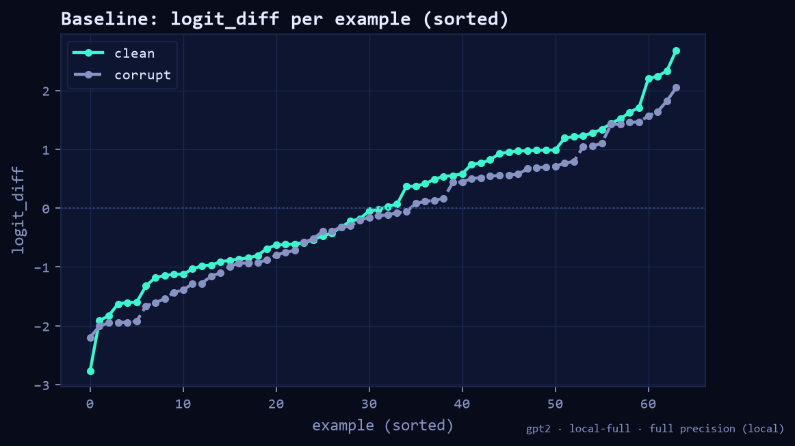
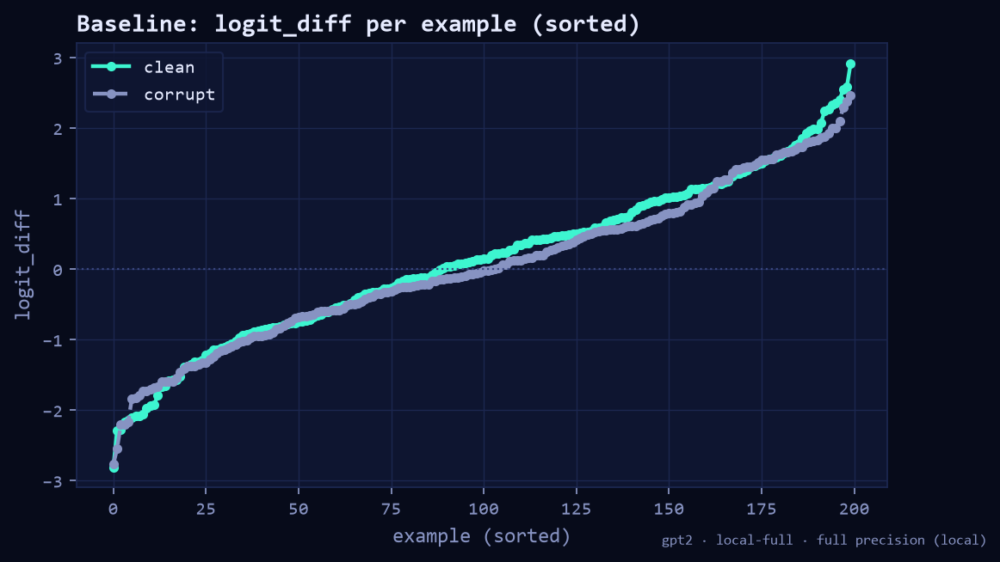

# IOI in the loaded gpt2 (local-full): behaviour absent, no mechanism to explain

**Behavior:** Given 'When Mary and John went to the store, John gave a drink to', the model is supposed to continue with the non-repeated name (' Mary') rather than the repeated one (' John'). Dataset task: ioi.  
**Model:** `gpt2` on `local-full`  
**Status:** unverified (no verification run) · null result: behaviour not present  
**Experiments run:** 3 · **Backends used:** full precision (local)  
**Written:** 2026-11-13 12:09

## Summary

The model loaded as gpt2 on local-full (full precision) does not do this. On 264 clean IOI prompts across two seeds its top-1 prediction was never the indirect object (accuracy 0.0); the top tokens were unrelated word pieces such as ' ali', ' Sov', ' calves'. The mean logit difference between the correct and the repeated name was 0.07 (n=64, std 1.19) and 0.12 (n=200, std 1.16), both within about 1.5 standard errors of zero and no different from the corrupted prompts (-0.15 and 0.04). The investigation was stopped after the baseline, as the protocol requires: there is no behaviour, so no circuit was searched for, no algorithm was written and no verification was attempted.

## The recovered algorithm

```python
# No algorithm recovered. The model does not prefer IO over S (E0002, E0003).
# Its output on these prompts is not a name at all, so no predict() is claimed.
```

## Claims and evidence

| # | Claim | Evidence | Produced by |
|---|---|---|---|
| 1 | On 64 clean IOI prompts (seed 0, local-full, full precision) top-1 accuracy is 0.0 and the mean IO-minus-S logit difference is 0.072 with std 1.19, i.e. indistinguishable from zero; the pre-registered prediction of at least 90% accuracy was refuted. | E0002 | full precision (local) |
| 2 | The null replicates on 200 fresh prompts (seed 1, local-full, full precision): accuracy 0.0, mean logit difference 0.123 with std 1.16 (standard error about 0.08); the pre-registered prediction that the mean lies within +/-0.3 of zero was confirmed. | E0003 | full precision (local) |
| 3 | Clean and corrupted prompts give the same logit difference within noise (clean 0.072 / 0.123 versus corrupt -0.151 / 0.040), so the repetition of the subject name has no measurable effect on the name preference. | E0002, E0003 | full precision (local) |

## Key plots

**E0002: baseline** (full precision (local))



**E0003: baseline** (full precision (local))



## Limitations

- Only the baseline was measured. Nothing in this report says anything about internal components.
- Why the behaviour is absent was not measured. The investigation name suggests a randomly initialised null model, and the nonsense top-1 tokens are consistent with that, but no experiment here tested the weights, so this is not a finding.
- A very small IO preference (below roughly 0.3 logits) cannot be excluded with 264 prompts; it would be far too weak to produce the described behaviour.
- No verify_hypothesis run: there was no hypothesis about a mechanism to verify.

## Open questions

- Is the loaded checkpoint the trained gpt2 or a null (random-init) model? A baseline on the pretrained weights would settle whether the question applies to that model.

## Prediction record

2 experiments were pre-registered, 2 were run: **1 confirmed, 1 refuted, 0 inconclusive**. Hit rate (confirmed / decided): **50%**.

Refuted predictions (shown, not hidden):

| prereg | experiment | hypothesis | predicted | observed |
|---|---|---|---|---|
| N0003 | E0002 | The loaded gpt2 does the IOI behaviour: on clean prompts it prefers the non-repeated name (IO) over the repeated one (S) in the large majority of cases. | `summary.clean_accuracy >= 0.9` | 0.000 |

## Experiments

| id | primitive | backend / precision | seconds | pre-registration |
|---|---|---|---|---|
| E0001 | dataset | full precision (local) | 0.02 | exploratory |
| E0002 | baseline | full precision (local) | 0.65 | N0003: refuted |
| E0003 | baseline | full precision (local) | 0.6 | N0006: confirmed |

## Notebook trail

- `N0001` *decision*: Loaded gpt2 on local-full (full precision (local)).
- `N0002` *experiment*: dataset (E0001)
- `N0003` *prereg*: The loaded gpt2 does the IOI behaviour: on clean prompts it prefers the non-repeated name (IO) over the repeated one (S) in the large majority of cases.
- `N0004` *experiment*: The loaded gpt2 does the IOI behaviour: on clean prompts it prefers the non-repeated name (IO) over the repeated one (S) (E0002)
- `N0005` *result*: Baseline REFUTED the prediction that the model does IOI (local-full, full precision, n=64, seed 0). Top-1 accuracy 0.0; top predictions are unrelated tokens (' Sov', ' ali'), not names. Mean logit diff IO-S = 0.072 with std 1.19 (standard error ~0.15, so indistinguishable from 0); the corrupt prompts give -0.151, same range. Per-prompt logit diffs scatter symmetrically around 0. The behaviour described in the question is not present in this loaded model. (E0002)
- `N0006` *prereg*: The absence of the IOI behaviour in E0002 is not a small-sample accident: on a fresh, larger sample the mean IO-minus-S logit difference is again indistinguishable from zero.
- `N0007` *experiment*: The absence of the IOI behaviour in E0002 is not a small-sample accident: on a fresh, larger sample the mean IO-minus-S  (E0003)
- `N0008` *result*: Replication on fresh data (local-full, full precision, n=200, seed 1): accuracy 0.0, mean logit diff IO-S = 0.123, std 1.164 (standard error ~0.082, i.e. 1.5 SE from zero, not significant). Corrupt prompts: 0.040. Top predictions again non-name tokens (' ali', ' calves', ' Nic'). Prediction 'within +/-0.3 of zero' confirmed. Both baselines agree: this model shows no IOI behaviour. (E0002, E0003)
- `N0009` *decision*: Stop the investigation at step 1. The model does not perform the behaviour (accuracy 0.0 on 264 prompts, logit diff indistinguishable from 0), so there is no mechanism to explain. Running screens, patching or verify_hypothesis would only fit a circuit to noise. No circuit, no predict() code, no verification claimed. 57 of 60 experiments left unused on purpose. (E0002, E0003)
