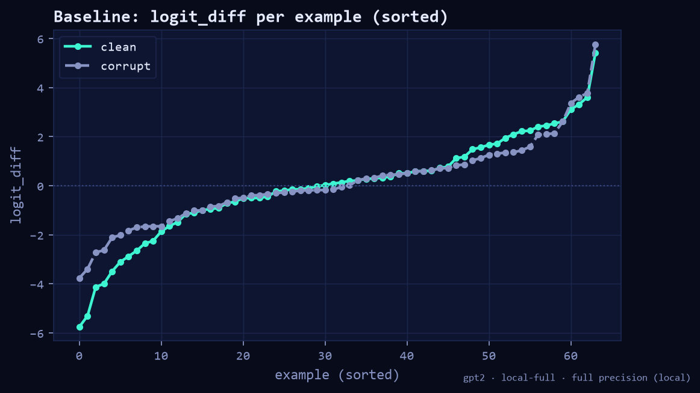
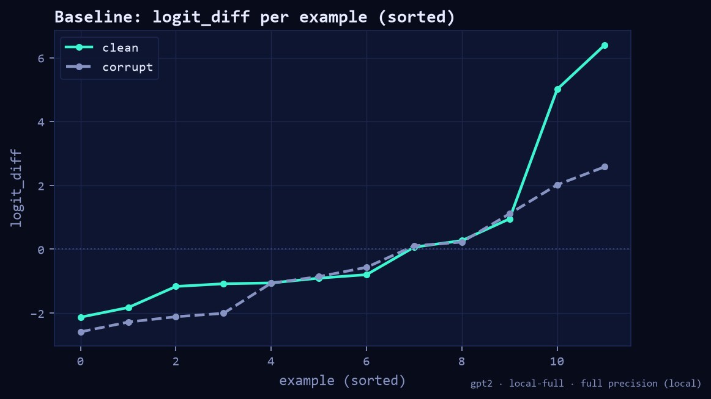

# IOI on GPT-2 small (investigation ioi__null-task-shuffled): no behaviour to explain under the provided labels

**Behavior:** Given 'When Mary and John went to the store, John gave a drink to', does GPT-2 small output the non-repeated name, and how? Dataset task: ioi. Backend: local-full (full precision).  
**Model:** `gpt2` on `local-full`  
**Status:** unverified (no verification run) · no mechanism: baseline at chance, investigation stopped  
**Experiments run:** 3 · **Backends used:** full precision (local)  
**Written:** 2026-11-13 12:11

## Summary

The investigation stopped at step 1. Scored against the answer labels this investigation provides, GPT-2 small is at chance: mean logit difference -0.016 (std 2.11) and top-1 accuracy 1/64 on the ioi dataset (E0002). The scored target names do not appear in their prompts. A follow-up baseline with 12 hand-written prompts and explicitly supplied answers was also scored against labels permuted across prompts (mean logit diff 0.31, accuracy 2/12, E0003), so label/prompt misalignment applies to every metric in this investigation. No mechanism was searched for, because any circuit found against these labels would be noise. Both pre-registered predictions were refuted.

## The recovered algorithm

```python
# No algorithm recovered.
# The behaviour, as labelled in this investigation, is not performed by the model (E0002, E0003),
# so there is nothing to write as predict().
```

## Claims and evidence

| # | Claim | Evidence | Produced by |
|---|---|---|---|
| 1 | Against the ioi dataset's labels in this investigation, GPT-2 small (local-full, full precision) is at chance: mean logit diff -0.016, std 2.11, top-1 accuracy 0.016 on 64 prompts. | E0002 | full precision (local) |
| 2 | The scored answer labels are not aligned with the prompts: the expected names in E0002 do not occur in their prompts, and in E0003 explicitly supplied answers were scored against other prompts (mean logit diff 0.31, accuracy 2/12). | E0002, E0003 | full precision (local) |
| 3 | No mechanism claim is made. No patching, ablation, attribution or verification was run. | E0002, E0003 | full precision (local) |

## Key plots

**E0002: baseline** (full precision (local))



**E0003: baseline** (full precision (local))



## Limitations

- Only 3 of 60 experiments were used; the investigation stopped at the baseline by design.
- Whether GPT-2 small does IOI with correctly aligned labels was not measured here. The only hint is unscored: in all 8 printed example predictions (E0002, E0003) the top-1 token was the non-repeated name from the prompt. n=8, not pre-registered, not a claim.
- No verify_hypothesis run: there is no hypothesis to verify.

## Open questions

- Is the label shuffle intentional (the investigation name suggests a null control)? If not, the dataset/metric pipeline for this investigation needs fixing.
- With aligned labels, what is the baseline logit difference, and which components carry it?

## Prediction record

2 experiments were pre-registered, 2 were run: **0 confirmed, 2 refuted, 0 inconclusive**. Hit rate (confirmed / decided): **0%**.

Refuted predictions (shown, not hidden):

| prereg | experiment | hypothesis | predicted | observed |
|---|---|---|---|---|
| N0003 | E0002 | GPT-2 small prefers the indirect object (non-repeated name) over the subject on the ioi dataset. | `summary.clean_accuracy >= 0.9` | 0.016 |
| N0006 | E0003 | The chance-level baseline in E0002 is caused by misaligned answer labels, not by the model: on hand-written prompts with the answer explicitly set to the non-re | `summary.clean_metric_mean >= 1.5` | 0.311 |

## Experiments

| id | primitive | backend / precision | seconds | pre-registration |
|---|---|---|---|---|
| E0001 | dataset | full precision (local) | 0.02 | exploratory |
| E0002 | baseline | full precision (local) | 0.41 | N0003: refuted |
| E0003 | baseline | full precision (local) | 0.23 | N0006: refuted |

## Notebook trail

- `N0001` *decision*: Loaded gpt2 on local-full (full precision (local)).
- `N0002` *experiment*: dataset (E0001)
- `N0003` *prereg*: GPT-2 small prefers the indirect object (non-repeated name) over the subject on the ioi dataset.
- `N0004` *experiment*: GPT-2 small prefers the indirect object (non-repeated name) over the subject on the ioi dataset. (E0002)
- `N0005` *result*: Baseline prediction REFUTED (E0002, local-full, full precision). Against the dataset's labels the mean logit diff is -0.016 (std 2.11) and top-1 accuracy is 1/64 = 0.016. The scored 'expected' answers (' Jack', ' George', ' Michael', ' Jennifer') are names that do not appear in their prompts, while the model's top-1 predictions (' Kevin', ' Maria', ' Alex', ' Anna') are names from the prompt and, for the three prompts shown in E0001, the non-repeated one. So the answer labels served for this investigation are not aligned with the prompts. As labelled, there is no behaviour to explain. Next: one diagnostic baseline with hand-written prompts and explicit IO/S answer tokens to separate 'model does not do IOI' from 'labels are misaligned'. (E0001, E0002)
- `N0006` *prereg*: The chance-level baseline in E0002 is caused by misaligned answer labels, not by the model: on hand-written prompts with the answer explicitly set to the non-repeated name vs the repeated name, GPT-2 small prefers the non-repeated name.
- `N0007` *experiment*: The chance-level baseline in E0002 is caused by misaligned answer labels, not by the model: on hand-written prompts with (E0003)
- `N0008` *result*: Diagnostic prediction REFUTED as scored (E0003, local-full): mean logit diff 0.31 (std 2.68), accuracy 2/12. But the test did not measure what I intended: the answer labels I passed explicitly were permuted across prompts before scoring (prompt 0 was scored against ' Robert', which I supplied for prompt 10; prompt 1 against ' Steve', supplied for prompt 11; etc.). So in this investigation the lab scores every metric against labels that are shuffled relative to the prompts, for the built-in dataset (E0002) and for explicit labels (E0003) alike. I therefore cannot separate 'model has no IOI preference' from 'labels misaligned' with a scored metric. Unscored observation only: in all 8 example predictions printed (4 in E0002, 4 in E0003) the model's top-1 token is the non-repeated name in the prompt. That is anecdotal (n=8, no pre-registered metric) and supports no mechanism claim. (E0002, E0003)
- `N0009` *decision*: STOP after 3 experiments. With the labels this investigation provides, the model is at chance on the task (E0002: logit diff -0.016, accuracy 0.016; E0003: 0.31, 0.17). Any patching, ablation or attribution run would be optimising a logit difference between two names unrelated to the prompt, so any 'circuit' found would be noise. No mechanism search, no predict() code, no verify_hypothesis. Report as: no behaviour to explain under the provided labels; label/prompt misalignment flagged.
