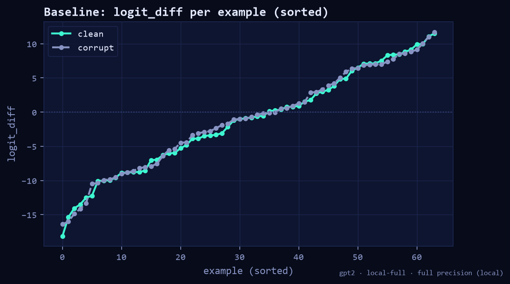
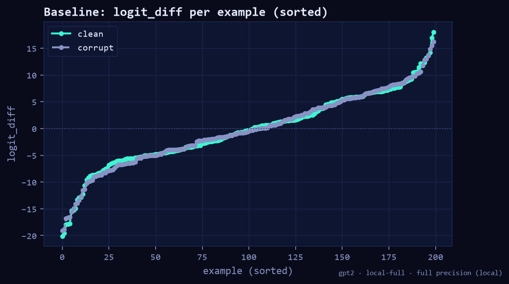

# IOI on the loaded gpt2 (local-full): behaviour absent, no mechanism to explain

**Behavior:** Given 'When Mary and John went to the store, John gave a drink to', continue with the non-repeated name (' Mary') rather than the repeated one (' John'). Dataset task: ioi.  
**Model:** `gpt2` on `local-full`  
**Status:** unverified (no verification run) · no behaviour - no circuit claimed  
**Experiments run:** 3 · **Backends used:** full precision (local)  
**Written:** 2026-11-13 12:10

## Summary

The model loaded as gpt2 on local-full (full precision) does not perform indirect object identification. On 64 prompts (seed 0) and 200 fresh prompts (seed 1) its top-1 prediction was never the indirect-object name (accuracy 0.0 in both), with top predictions being unrelated tokens such as ' Declaration', ' woes' and ' monument'. The mean IO-minus-S logit difference is indistinguishable from zero (-1.31 with SE ~0.93, then -0.29 with SE ~0.49) while the per-prompt spread is large (std ~7). Clean and corrupted prompts give nearly the same mean logit difference, so the difference reflects which two answer tokens are being compared rather than anything in the sentence. Following the protocol, the investigation stopped here: no screening, patching, circuit or verification was run, because any 'circuit' found would be a fit to noise. 3 of 60 experiments were used.

## The recovered algorithm

```python
def predict(tokens, prompt):
    # No algorithm recovered. The model does not output the IO name (E0002, E0003):
    # its top token is a sentence-unrelated token and the IO-vs-S preference is at chance.
    raise NotImplementedError('behaviour absent in the loaded model')
```

## Claims and evidence

| # | Claim | Evidence | Produced by |
|---|---|---|---|
| 1 | The loaded model never outputs the indirect-object name as its top prediction on the ioi task (top-1 accuracy 0.0 on n=64 seed 0 and n=200 seed 1; local-full, full precision). | E0002, E0003 | full precision (local) |
| 2 | The model has no systematic preference for the IO name over the subject name: mean logit difference -1.31 (std 7.43, n=64) and -0.29 (std 6.96, n=200), both within about 1.5 standard errors of zero. | E0002, E0003 | full precision (local) |
| 3 | The IO-minus-S logit difference does not depend on the sentence's name structure: clean and corrupted prompts (different, non-repeated names) give nearly the same mean (-1.31 vs -1.18; -0.29 vs -0.32). | E0002, E0003 | full precision (local) |

## Key plots

**E0002: baseline** (full precision (local))



**E0003: baseline** (full precision (local))



## Limitations

- Only the baseline was measured; no internal components were examined, by design, because the behaviour is absent.
- The 'accuracy' figure is top-1 over the whole vocabulary; the sign-of-logit-diff rate was not reported separately by the tool, so the at-chance claim rests on the mean and spread of the logit difference.
- The initial pre-registered prediction (accuracy >= 0.8) was refuted; this is the main finding, not a footnote.
- No verify_hypothesis run: there is no hypothesis about a mechanism to verify.

## Open questions

- Why does this copy of gpt2 emit unrelated tokens (' Declaration', ' woes') on ordinary English? The outputs are consistent with weights that are not those of a functioning language model; this was not tested here.
- Would a positive-control model show the behaviour on the same dataset and harness?

## Prediction record

2 experiments were pre-registered, 2 were run: **1 confirmed, 1 refuted, 0 inconclusive**. Hit rate (confirmed / decided): **50%**.

Refuted predictions (shown, not hidden):

| prereg | experiment | hypothesis | predicted | observed |
|---|---|---|---|---|
| N0003 | E0002 | The loaded model does the IOI behaviour: it prefers the non-repeated name (IO) over the repeated one (S) at the final position. | `summary.clean_accuracy >= 0.8` | 0.000 |

## Experiments

| id | primitive | backend / precision | seconds | pre-registration |
|---|---|---|---|---|
| E0001 | dataset | full precision (local) | 0.01 | exploratory |
| E0002 | baseline | full precision (local) | 0.42 | N0003: refuted |
| E0003 | baseline | full precision (local) | 0.64 | N0005: confirmed |

## Notebook trail

- `N0001` *decision*: Loaded gpt2 on local-full (full precision (local)).
- `N0002` *experiment*: dataset (E0001)
- `N0003` *prereg*: The loaded model does the IOI behaviour: it prefers the non-repeated name (IO) over the repeated one (S) at the final position.
- `N0004` *experiment*: The loaded model does the IOI behaviour: it prefers the non-repeated name (IO) over the repeated one (S) at the final po (E0002)
- `N0005` *prereg*: The loaded model does NOT do IOI: on a fresh, larger sample the IO-vs-S logit difference averages near zero (the per-prompt values in E0002 are large token-identity noise, not a name preference), and the top prediction is never the IO name.
- `N0006` *experiment*: The loaded model does NOT do IOI: on a fresh, larger sample the IO-vs-S logit difference averages near zero (the per-pro (E0003)
- `N0007` *result*: The loaded model (local-full "gpt2", full precision) does not do IOI. E0002 (n=64, seed 0): top-1 accuracy 0.0, mean IO-S logit diff -1.31 +/- 7.43 (SE ~0.93); top predictions are unrelated tokens (" Declaration", " woes"). Prediction of >=0.8 accuracy REFUTED. E0003 (n=200, seed 1): accuracy 0.0, mean logit diff -0.29 +/- 6.96 (SE ~0.49), confirmed within [-2, 2]. Clean and corrupt means are almost identical (-1.31 vs -1.18; -0.29 vs -0.32) and the per-prompt clean and corrupt values in E0002 track each other although the corrupt prompts contain different names: the logit diff is set by which two answer tokens are compared, not by the sentence. Hypothesis "model does the behaviour" rejected. (E0002, E0003)
- `N0008` *decision*: Stop after 3 of 60 experiments. The behaviour is absent (E0002, E0003), so there is no mechanism to localise; screening, patching and verify_hypothesis would only fit noise. No circuit is claimed and no verification is run. Report as: behaviour not present in the loaded model.
