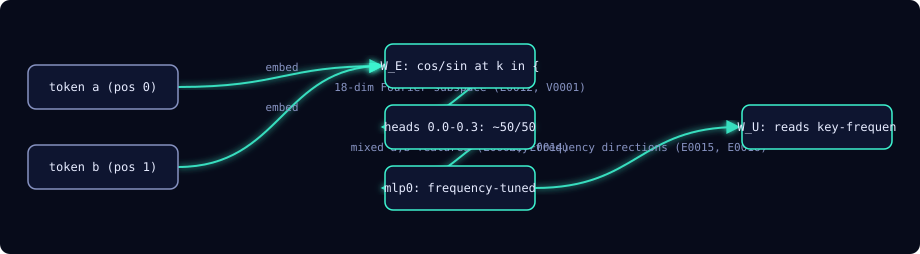
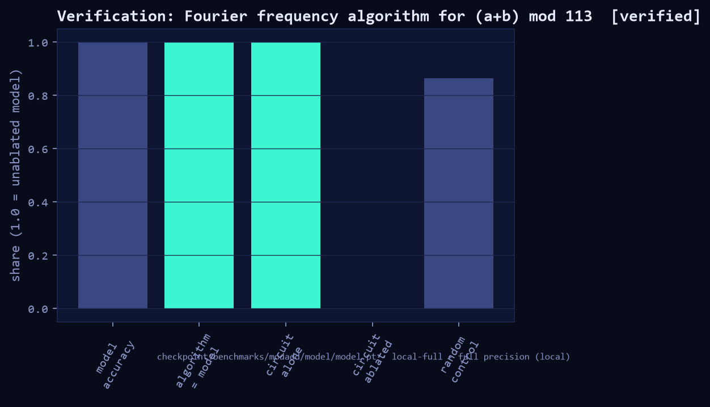
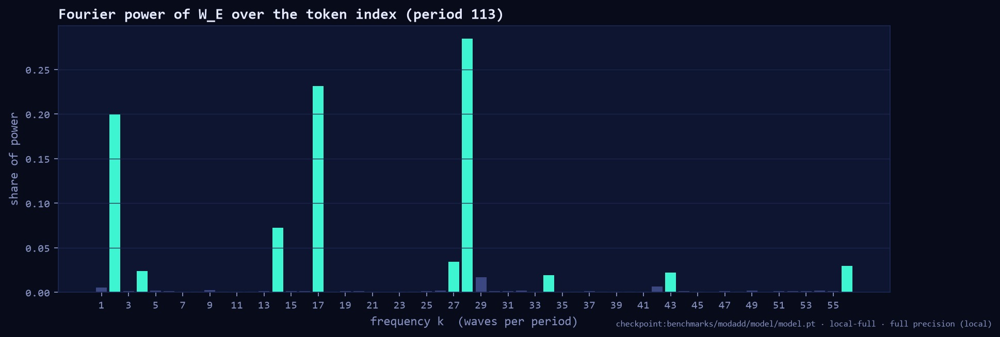
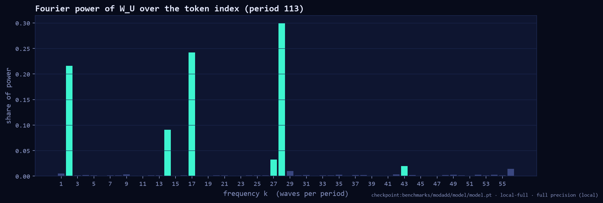
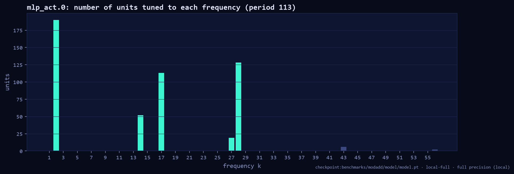
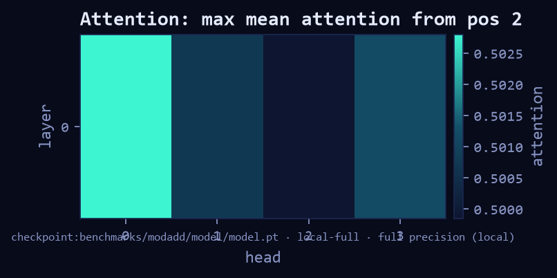
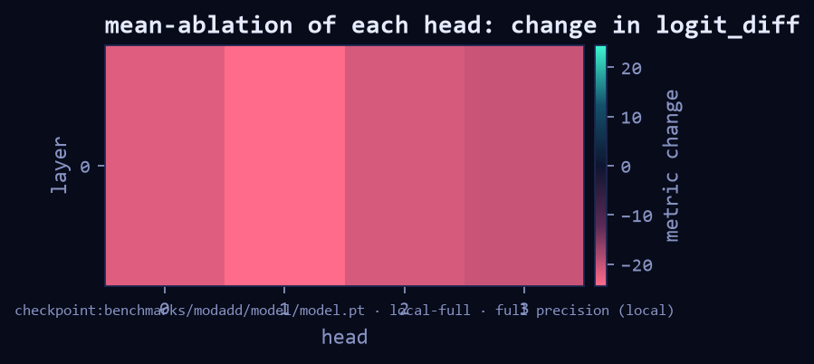
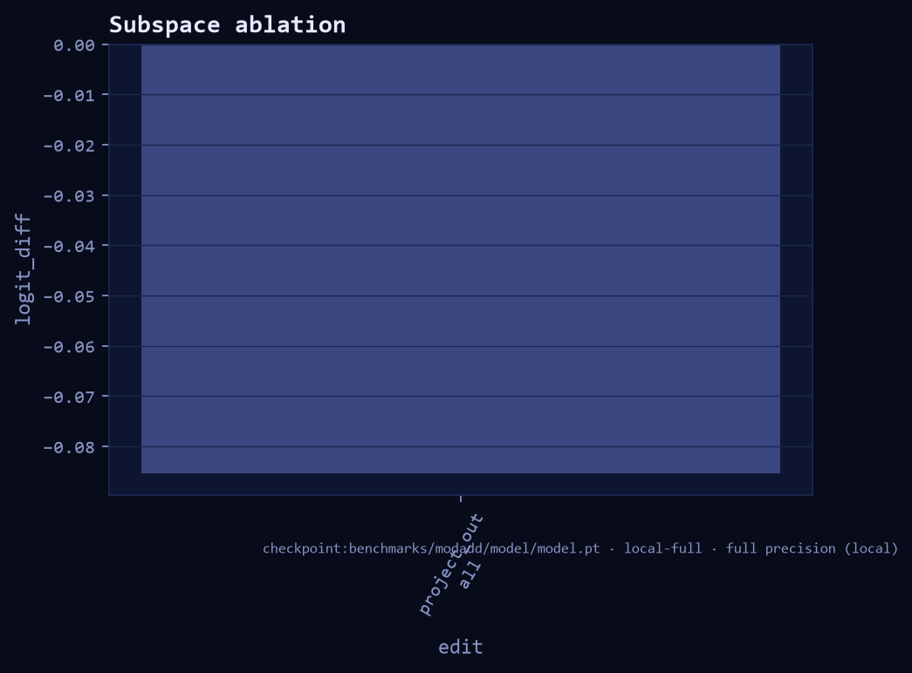

# How a 1-layer transformer computes (a+b) mod 113: a sparse Fourier-frequency algorithm

**Behavior:** Input [a, b, '='] with a, b in 0..112 ('=' is token 113); at the last position the model outputs (a+b) mod 113. Accuracy 1.0 on all 12769 pairs (E0002).  
**Model:** `checkpoint:benchmarks/modadd/model/model.pt` on `local-full`  
**Status:** verified · verified (local-full, full precision)  
**Experiments run:** 16 · **Backends used:** full precision (local)  
**Written:** 2026-11-12 22:37

## Summary

The model represents numbers as waves (cos/sin) at a small set of frequencies mod 113: mainly 28, 17, 2 and 14, with 27 and a few minor ones. The embedding (E0003), the MLP neurons (E0011), the MLP output (E0015) and the unembedding (E0004) all use this same set. All 4 attention heads at '=' split attention ~50/50 between a and b (E0009, E0010). They act together as a mixer (only joint ablation kills the behaviour, E0006/E0008) and write almost nothing to the logits directly (E0014). mlp0 is necessary (E0007): its neurons each tune to one key frequency and write key-frequency directions that W_U reads out (E0016). The 18-dim key-frequency subspace of the operand embeddings is necessary (E0012) and sufficient (V0001: keeping only it gives 99.8% of the logit diff). On held-out data the Fourier algorithm agrees with the model on 1000/1000 inputs (V0001). All numbers are from local-full (fp32).

## The recovered algorithm

```python
P = 113; K = [2, 14, 17, 27, 28]            # key frequencies (E0003, E0004, E0011)
def predict(a, b):
    # 1. embed: a, b -> cos/sin(2*pi*k*x/P) for k in K       (E0003; necessary E0012, sufficient V0001)
    # 2. attention (4 heads, ~50/50 on a and b) mixes them at '='   (E0009, E0010, E0008)
    # 3. mlp0: frequency-tuned neurons combine a and b features   (E0011, E0015; necessary E0007)
    # 4. unembed reads key-frequency directions                   (E0004, E0016)
    logit = [sum(cos(2*pi*k*(a+b-c)/P) for k in K) for c in range(P)]
    return argmax(logit)                                          # = (a+b) mod P  (V0001: 1000/1000)
```

## Circuit



## Claims and evidence

| # | Claim | Evidence | Produced by |
|---|---|---|---|
| 1 | The model does the task perfectly: accuracy 1.0 on all 12769 pairs, mean logit diff 72.4. | E0002 | full precision (local) |
| 2 | The token embedding is sparse in the Fourier basis mod 113: frequencies 28, 17, 2, 14 hold 28.5/23.1/20.0/7.2% of power (uniform would be 1.8%); 9 key frequencies hold 91.8%. | E0003 | full precision (local) |
| 3 | The unembedding uses the same frequencies (28/17/2/14 = 30.0/24.2/21.6/9.1%); 6 key frequencies hold 90.1% of power. | E0004 | full precision (local) |
| 4 | The MLP neurons cluster by frequency: k=2:190, 28:128, 17:113, 14:52, 27:19; on average 70% of a neuron's variance is on one frequency. | E0011 | full precision (local) |
| 5 | All 128 dims of the MLP output at '=' are periodic with best frequency in {28, 17, 2}. | E0015 | full precision (local) |
| 6 | From '=', each head attends ~50% to its top operand and ~0.2% to '=' itself, so attention mixes a and b ~50/50 on average. | E0009, E0010 | full precision (local) |
| 7 | The heads share the work: each one ablated alone removes 28-34% of the logit diff, while all 4 together reduce it to ~0. | E0006, E0008 | full precision (local) |
| 8 | The heads write only 1.2% of the logit diff directly; mlp0 is necessary (mean ablation leaves 1.4%). | E0014, E0007 | full precision (local) |
| 9 | The key-frequency subspace (18 of 128 dims) of the a and b embeddings is necessary (ablated: 0%) and sufficient (kept alone: 99.8%, 100% accuracy). A random 18-dim ablation keeps 86.4%. | E0012, V0001 | full precision (local) |
| 10 | The read-out goes through the 12-dim W_U key-frequency subspace: ablating it in resid_post at '=' leaves 0.2% of the logit diff. | E0016 | full precision (local) |
| 11 | The Fourier algorithm predict() agrees with the model on 1000/1000 held-out inputs (seed 7). | V0001 | full precision (local) |

## Verification

### V0001: Fourier frequency algorithm for (a+b) mod 113  (full precision (local))

| check | value |
|---|---|
| status | verified |
| held-out inputs | 1000 |
| model accuracy | 1.000 |
| algorithm agrees with model | 1.000 |
| algorithm accuracy vs ground truth | 1.000 |
| subspace size | 18 of 128 dims |
| accuracy with ONLY the subspace | 1.000 |
| accuracy with the subspace REMOVED | 0.009 |
| accuracy with a random subspace removed (control) | 1.000 |

Passed at full precision.



## Key plots

**E0003: periodicity** (full precision (local))



**E0004: periodicity** (full precision (local))



**E0011: periodicity** (full precision (local))



**E0009: attention_patterns** (full precision (local))



**E0006: ablation** (full precision (local))



**E0012: ablation** (full precision (local))



## Limitations

- Everything was measured on local-full (fp32); there is no quantized/screening data.
- Because the model is 100% accurate, 100% agreement in V0001 would hold for any correct algorithm. The exact logit form sum_k cos(w_k(a+b-c)) and the frequency weights were not fitted or measured directly.
- That the MLP multiplies a and b features (product-to-sum) is inferred from the frequency structure and the roles. It was not measured directly: periodicity (E0015) does not split a-only, b-only and (a+b) terms, and the linear probe for (a+b) before vs after the MLP failed because it needs an explicit label list.
- Attention numbers (E0009, E0010) are means; I did not measure how much the a/b split varies per example.
- E0013 (keep-only-subspace via 'complement') silently ignored the flag and duplicated E0012. It is not used as evidence; sufficiency comes from V0001.
- The DLA tool reported heads only; the MLP's direct logit share is inferred from E0007, not measured.
- No component-level 'ablate everything else' test: in a 1-layer model the claimed components are the whole model.

## Open questions

- Does each neuron's activation depend on cos/sin(w_k(a+b)) (the joint term) rather than on a and b separately? This needs a 2-D Fourier split or a probe with explicit labels.
- What does each frequency contribute? Ablate one frequency at a time to see whether any single one is enough or needed.
- Why do the 4 heads share the work evenly? Do they specialise by frequency?
- What role do the minor frequencies (4, 34, 43, 56) play?

## Experiments

| id | primitive | backend / precision | seconds |
|---|---|---|---|
| E0001 | dataset | full precision (local) | 0.0 |
| E0002 | baseline | full precision (local) | 0.84 |
| E0003 | periodicity | full precision (local) | 0.15 |
| E0004 | periodicity | full precision (local) | 0.13 |
| E0005 | attribution_patching | full precision (local) | 0.22 |
| E0006 | ablation | full precision (local) | 1.86 |
| E0007 | ablation | full precision (local) | 1.0 |
| E0008 | ablation | full precision (local) | 1.01 |
| E0009 | attention_patterns | full precision (local) | 0.12 |
| E0010 | attention_patterns | full precision (local) | 0.11 |
| E0011 | periodicity | full precision (local) | 0.59 |
| E0012 | ablation | full precision (local) | 0.85 |
| E0013 | ablation | full precision (local) | 1.38 |
| E0014 | direct_logit_attribution | full precision (local) | 0.66 |
| E0015 | periodicity | full precision (local) | 0.43 |
| E0016 | ablation | full precision (local) | 0.64 |
| V0001 | verify | full precision (local) |  |

## Notebook trail

- `N0001` *decision*: Loaded checkpoint:benchmarks/modadd/model/model.pt on local-full (full precision (local)).
- `N0002` *hypothesis* **[supported]**: H1 (behaviour): the model computes (a+b) mod 113 at the last position with near-perfect accuracy over the full 113x113 grid. Against: baseline accuracy near chance (~1/113).
- `N0003` *experiment*: dataset (E0001)
- `N0004` *experiment*: baseline (E0002)
- `N0005` *result* **[supported]** -> N0002: E0002 (local-full): accuracy 1.0 on all 12769 pairs; mean logit diff 72.4 (clean) vs -72.5 (corrupt). H1 supported. (E0002)
- `N0006` *hypothesis* **[supported]**: H2 (embedding structure): the token embedding W_E over integers 0..112 is sparse in the Fourier basis mod 113 — a handful of key frequencies carry most of the norm. Against: Fourier power spread roughly evenly across all 56 frequencies (no frequency with >>1/56 share).
- `N0007` *experiment*: periodicity (E0003)
- `N0008` *result* **[supported]** -> N0006: E0003 (local-full): W_E Fourier power is sparse. Top frequencies 28 (28.5%), 17 (23.1%), 2 (20.0%), 14 (7.2%); uniform share would be 1.8%. 9 key freqs hold 91.8% of power. Saved subspace A0001 (dim 18). (E0003)
- `N0009` *hypothesis* **[supported]**: H3 (output structure): W_U (over output classes 0..112) is sparse in Fourier space, concentrated on the same main frequencies as W_E (28, 17, 2, 14). Against: W_U's top frequencies are different from W_E's, or W_U's power is spread out.
- `N0010` *experiment*: periodicity (E0004)
- `N0011` *result* **[supported]** -> N0009: E0004 (local-full): W_U uses the same top frequencies, 28 (30.0%), 17 (24.2%), 2 (21.6%), 14 (9.1%), then 27 and 43. 6 key freqs hold 90.1% of power. The input and output sides share one frequency set {2,14,17,28} (plus minor 27, 43). (E0004)
- `N0012` *hypothesis* **[open]**: H4 (where): the attention heads at position 2 move a and b information from positions 0/1 into the '=' position, and the MLP at position 2 does the nonlinear combination; all of these matter. Screen: attribution patching over heads/layers/positions. Against: the attention heads or the MLP have negligible attribution.
- `N0013` *experiment*: attribution_patching (E0005)
- `N0014` *result*: E0005 (local-full, attribution estimate, n=512 seed 1): mlp_out at pos 2 = 0.99 normalised effect, attn_out at pos 2 = 0.59, the 4 heads are similar (0.14-0.17 each), resid at pos 0 and pos 1 = 0.28 each. Only pos 2 outputs matter (attn/mlp at pos 0,1 = 0). This fits H4 but is a first-order estimate; next I confirm with exact ablation. (E0005)
- `N0015` *hypothesis* **[revised]**: H4a: mean-ablating each of the 4 heads on its own, and mlp0 on its own, hurts accuracy a lot; the heads share the work (no one head is enough). Against: some head can be ablated with accuracy staying ~1.0 (it is redundant), or ablating mlp0 leaves accuracy high.
- `N0016` *experiment*: ablation (E0006)
- `N0017` *result* **[revised]** -> N0015: E0006 (local-full, full grid, mean ablation): each head alone removes 28-34% of the logit diff (0.1: 72.4->47.9; 0.0: ->50.3; 0.2: ->51.2; 0.3: ->52.0). All 4 matter about equally, but none is needed on its own: the logit diff stays ~50, which is still a big margin. Revised: the heads share the work (each carries part of the frequency set?). Still to test: mlp0 alone, and all heads together. (E0006)
- `N0018` *hypothesis* **[supported]**: H4b: mean-ablating mlp0 alone destroys the behaviour (logit diff near 0 or below, accuracy near chance), and so does jointly mean-ablating all 4 heads. Against: logit diff stays well above 0 after either ablation.
- `N0019` *experiment*: ablation (E0007)
- `N0020` *experiment*: ablation (E0008)
- `N0021` *result* **[supported]** -> N0018: E0007: mean-ablating mlp0 drops the logit diff from 72.4 to 1.03 (1.4% of clean). E0008: jointly mean-ablating all 4 heads drops it to -0.07 (0%). Both the attention block and the MLP are necessary. H4b supported. (E0007, E0008)
- `N0022` *hypothesis* **[supported]**: H5 (attention reads): from the '=' query (pos 2), every head splits its attention between pos 0 (a) and pos 1 (b), with little on pos 2 itself, so each head output holds a mix of the a and b embeddings. Against: some head puts >70% on '=' or attends to only one operand everywhere.
- `N0023` *experiment*: attention_patterns (E0009)
- `N0024` *experiment*: How much attention goes from '=' to itself? (tests H5) (E0010)
- `N0025` *result* **[supported]** -> N0022: E0009/E0010 (local-full, n=1024 seed 2): from the '=' query, each head's mean attention to its most-attended operand is 0.500-0.503, and attention to '=' itself is only 0.0018-0.0021. So on average each head attends ~50/50 to a and b. The head outputs are a near-equal mix of the a and b token values, so the attention adds the two embedding signals together and does not do the arithmetic. Limitation: this is a mean; I did not measure how much the a/b split varies from example to example. (E0009, E0010)
- `N0026` *hypothesis* **[supported]**: H6 (MLP reads): the MLP neuron activations at pos 2, seen as a function of the operand a (and of b), are periodic with the same key frequencies {2,14,17,28} found in W_E/W_U. Against: the key frequencies of the MLP activations differ from W_E's, or the power is spread out.
- `N0027` *experiment*: periodicity (E0011)
- `N0028` *result* **[supported]** -> N0026: E0011 (local-full, full grid): 510/512 neurons are active; on average 70% of a neuron's variance is on one frequency, and 199 neurons have >85% on one. Neurons cluster by frequency: k=2: 190, k=28: 128, k=17: 113, k=14: 52, k=27: 19 (a few at 43/56). This is the same frequency set as W_E/W_U (E0003, E0004). The MLP works in separate frequency channels. (E0011)
- `N0029` *hypothesis* **[open]**: H7 (the information used is only the key-frequency Fourier components): replacing the a and b embeddings with their mean, while keeping only their projection onto the 18-dim key-frequency subspace A0001, leaves performance near clean. Mean-ablating that subspace destroys it. Against: keeping the subspace alone gives <70% of the clean logit diff, or ablating it leaves >30%.
- `N0030` *experiment*: Ablate the key-frequency subspace of the embeddings at a and b (E0012)
- `N0031` *experiment*: Ablate everything outside the key-frequency subspace (keep only A0001) (E0013)
- `N0032` *result* -> N0029: E0012 (local-full, full grid): mean-ablating the 18-dim key-frequency subspace A0001 of the a and b embeddings drops the logit diff from 72.4 to -0.085 (0%). The necessity half of H7 is supported. E0013 tried to keep only that subspace with "complement": true, but it returned exactly the same number (-0.085451). The flag was evidently ignored, so E0013 is NOT a valid sufficiency test. The sufficiency half of H7 stays open; I will test it in verify_hypothesis (circuit-alone check with the subspace). (E0012, E0013)
- `N0033` *decision*: Tooling gap: the ablation primitive does not support a complement/keep-only subspace option (E0013 duplicates E0012). I am not retrying with guessed flags. Sufficiency goes through verify_hypothesis, which does "ablate everything else" on its own. (E0013)
- `N0034` *hypothesis* **[supported]**: H8 (who writes the answer): the correct-answer logit is written directly mostly by mlp0. The heads mainly feed the MLP (their direct logit contribution is small, <25% of the total). Against: heads' direct logit attribution is comparable to or bigger than mlp0's.
- `N0035` *experiment*: direct_logit_attribution (E0014)
- `N0036` *result* **[supported]** -> N0034: E0014 (local-full, full grid): the 4 heads write only 0.90 of the 72.4 logit diff directly (1.2%): 0.0=0.30, 0.1=0.25, 0.3=0.21, 0.2=0.15. The DLA tool reported heads only; the MLP number was not given. With E0007 (mlp0 ablation -> 1.03), the answer is written by mlp0 (plus whatever passes through the residual). Heads act through the MLP, not directly. (E0014, E0007)
- `N0037` *hypothesis* **[open]**: H9 (the MLP does the multiplication): before the MLP (resid_mid at pos 2), the residual is a sum of separate a and b features, so the answer class (a+b) mod 113 is NOT linearly decodable there. After the MLP (mlp_act / resid_post at pos 2) it is linearly decodable with high accuracy. Against: the held-out probe accuracy for (a+b) mod 113 on resid_mid is already high (>50%), or it is low after the MLP.
- `N0038` *note* -> N0037: The linear_probe call for H9 failed (ValueError: the probe needs an explicit label list with one label per input; the string "answer" was read as 6 labels). Not counted as an experiment. H9 stays untested by probe; I'll try to get the same evidence from a 2-D Fourier look at the MLP output instead.
- `N0039` *hypothesis* **[revised]**: H10 (the MLP output is a function of a+b): the mlp_out vector at pos 2, over the full (a,b) grid, has its Fourier power on the key frequencies, and those components vary with (a+b) (the joint/diagonal terms), not with a or b alone. Against: mlp_out power sits mainly in a-only or b-only terms, or on frequencies outside the key set.
- `N0040` *experiment*: periodicity (E0015)
- `N0041` *result* **[revised]** -> N0039: E0015 (local-full, full grid): every one of the 128 mlp_out dims at pos 2 is periodic, with its best frequency in the key set: 28 (109 dims), 17 (14), 2 (5). On average 61% of a dim's variance is on one frequency. The MLP output is built from the key frequencies. The primitive only reports one best frequency per unit and does not split a-only / b-only / (a+b) terms, so the 'depends on a+b' half of H10 is NOT tested here. Revised to: mlp_out is built from key frequencies (supported); the a+b dependence is not shown by this experiment. (E0015)
- `N0042` *hypothesis* **[supported]**: H11 (read-out goes through the key frequencies): mean-ablating the 12-dim W_U key-frequency subspace A0002 (freqs 2,14,17,27,28,43) in resid_post at pos 2 destroys the logit diff (<10% of clean). Against: >30% of the clean logit diff survives.
- `N0043` *experiment*: ablation (E0016)
- `N0044` *result* **[supported]** -> N0042: E0016 (local-full, full grid): mean-ablating the 12-dim W_U key-frequency subspace A0002 in resid_post at pos 2 drops the logit diff from 72.4 to 0.14 (0.2% of clean). The answer is read out entirely through the key-frequency directions. Caveat: A0002 was derived from W_U itself, so this mainly confirms that the logit-relevant part of the residual lives in those 12 dims (out of 128). (E0016)
- `N0045` *hypothesis* **[supported]**: H12 (full algorithm): (1) W_E maps a and b to cos/sin features at key frequencies K={2,14,17,27,28,...} (E0003). (2) All 4 heads at '=' average the a and b token information ~50/50 (E0009, E0010), mixing them into one residual vector. (3) mlp0 neurons, each tuned to one frequency in K (E0011), combine the a and b features nonlinearly and write key-frequency directions (E0015). (4) W_U reads those directions at the same frequencies (E0004, E0016): logit(c) ~ sum_k alpha_k cos(w_k (a+b-c)), w_k=2*pi*k/113, which peaks at c=(a+b) mod 113. Verification test: on held-out seed 7, predict() matches the model ~100%; keeping only the key-frequency embedding subspace A0001 at a,b (everything else mean-ablated) keeps most of the logit diff; ablating that subspace breaks it; a random subspace of the same size does little. Against: circuit-alone retains <70%, or the random control breaks the behaviour about as much as the circuit.
- `N0046` *verification*: Fourier frequency algorithm for (a+b) mod 113: verified. Passed at full precision. (V0001)
- `N0047` *result* **[supported]** -> N0045: V0001 (local-full, held-out seed 7, n=1000): VERIFIED. predict() agrees with the model on 1000/1000. Keeping only the 18-dim key-frequency embedding subspace at a,b (110 of 128 dims mean-ablated) keeps 99.8% of the logit diff with 100% accuracy; this closes the sufficiency gap left by E0013. Removing that subspace gives -0.1% and 0.9% accuracy (chance ~0.9%). Removing a random 18-dim subspace keeps 86.4% with 100% accuracy. Caveat: since the model is 100% accurate, any correct algorithm would score 100% agreement. Agreement does not on its own show the exact logit shape sum_k cos(w_k(a+b-c)). The mechanism claims rest on E0003/E0004/E0011/E0015/E0012/E0016. (V0001, E0012, E0016)
