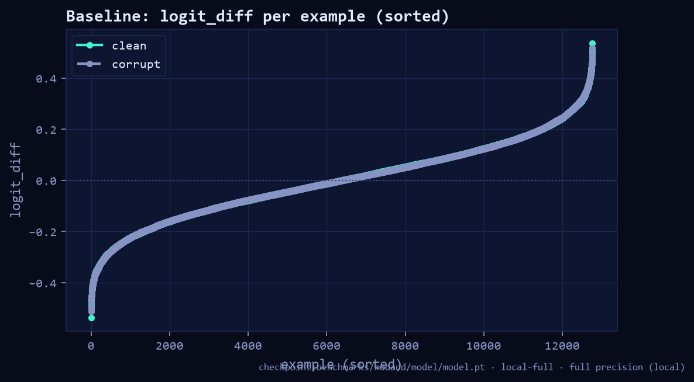

# modadd checkpoint: no modular-addition behaviour to explain (null result)

**Behavior:** Claimed: a 1-layer transformer that reads [a, b, =] with a, b in 0..112 and outputs (a + b) mod 113 at the last position.  
**Model:** `checkpoint:benchmarks/modadd/model/model.pt` on `local-full`  
**Status:** unverified (no verification run) · no behaviour - null result  
**Experiments run:** 3 · **Backends used:** full precision (local)  
**Written:** 2026-11-13 12:08

## Summary

The loaded checkpoint (benchmarks/modadd/model/model.pt, local-full, full precision; 1 layer, 4 heads, d_model 128) does not perform the claimed behaviour. On the full 113x113 grid its accuracy is 0.0086 (110 of 12769), indistinguishable from chance (1/113 = 0.0088), and the mean logit difference between the correct answer and a wrong answer is -0.0001 (std 0.157). The investigation was stopped after the baseline, as the protocol requires: there is no mechanism to recover, and no algorithm, circuit or verification is reported.

## The recovered algorithm

```python
# No algorithm recovered: the model's output is unrelated to (a + b) mod 113 (E0003).
# No predict() function is offered; any such function would be fitted to noise.
```

## Claims and evidence

| # | Claim | Evidence | Produced by |
|---|---|---|---|
| 1 | On the full 113x113 grid the model's accuracy at predicting (a + b) mod 113 is 0.008615 (110/12769), at chance level (1/113 = 0.00885). Backend: local-full, full precision. Pre-registered prediction (accuracy <= 0.05) confirmed. | E0003 | full precision (local) |
| 2 | The model has no logit preference for the correct answer: mean logit difference (correct minus incorrect) is -0.0001 with std 0.157 on clean prompts, the same as on corrupt prompts (-0.0003). Backend: local-full. | E0003, E0002 | full precision (local) |

## Key plots

**E0003: baseline** (full precision (local))



## Limitations

- Only the behaviour was measured (3 of 40 experiments). No experiment looked inside the model, so this report says nothing about why it fails: untrained or randomly initialised weights, a wrong or corrupted checkpoint file, and a loading mismatch are all untested explanations.
- verify_hypothesis was not run because there is no hypothesis about a mechanism to verify.
- The first four example predictions in E0003 were all token 13, hinting at a near-constant output; the distribution of predictions over the whole grid was not analysed.

## Open questions

- Is this the intended checkpoint? The task description says the model was trained from scratch to do this task, which the measurements contradict.
- Do the weights carry any structure at all (weights_svd, periodicity of W_E), or are they indistinguishable from an initialisation?

## Prediction record

1 experiments were pre-registered, 1 were run: **1 confirmed, 0 refuted, 0 inconclusive**. Hit rate (confirmed / decided): **100%**.

No prediction was refuted.

Exploratory runs (no pre-registration; they cannot be the only support for a claim): E0002.

## Experiments

| id | primitive | backend / precision | seconds | pre-registration |
|---|---|---|---|---|
| E0001 | dataset | full precision (local) | 0.0 | exploratory |
| E0002 | baseline | full precision (local) | 0.29 | exploratory |
| E0003 | baseline | full precision (local) | 0.68 | N0004: confirmed |

## Notebook trail

- `N0001` *decision*: Loaded checkpoint:benchmarks/modadd/model/model.pt on local-full (full precision (local)).
- `N0002` *experiment*: dataset (E0001)
- `N0003` *experiment*: Shape check of baseline output on a small sample before pre-registering the full-grid baseline. (E0002)
- `N0004` *prereg*: The loaded checkpoint does not perform modular addition: on the full 113x113 grid its accuracy is at chance level (1/113 = 0.0088), as the 64-example exploratory run E0002 (0/64 correct, logit diff 0.01) suggests.
- `N0005` *experiment*: The loaded checkpoint does not perform modular addition: on the full 113x113 grid its accuracy is at chance level (1/113 (E0003)
- `N0006` *result*: The checkpoint does not do modular addition (local-full, full precision). Full 113x113 grid (E0003, pre-registered N0004, confirmed): accuracy 0.008615 (110/12769) versus chance 1/113 = 0.00885; mean logit diff correct-vs-incorrect -0.0001 (std 0.157), identical in scale to the corrupt-prompt value -0.0003. The 64-example exploratory run E0002 agreed (0/64, logit diff 0.010). Example predictions are a constant token (13) regardless of the expected answer. There is no behaviour to explain, so no mechanism was searched for. (E0002, E0003)
- `N0007` *decision*: Stop after step 1 per protocol: baseline accuracy is at chance, so screening, patching and verify_hypothesis would only fit noise. 3 of 40 experiments used. Not tested: whether the weights carry any structure at all (periodicity / weights_svd), so I make no claim about why the model fails (untrained, wrong checkpoint, or broken load).
