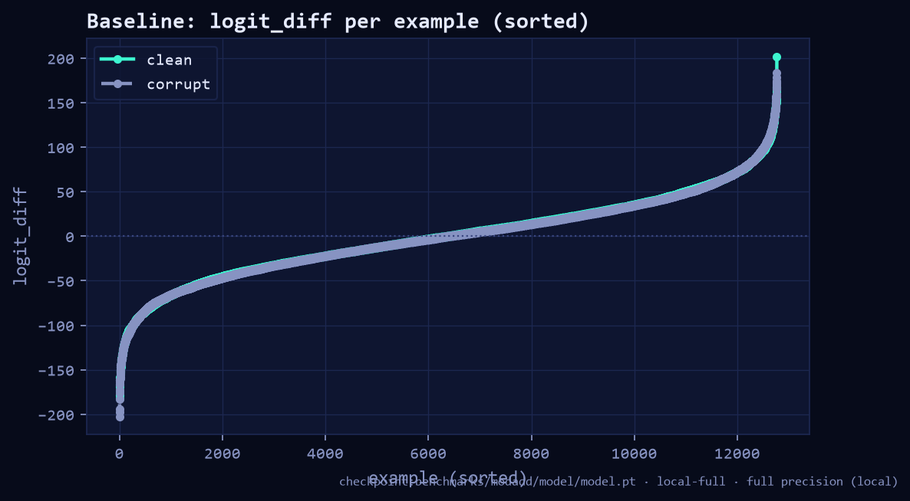
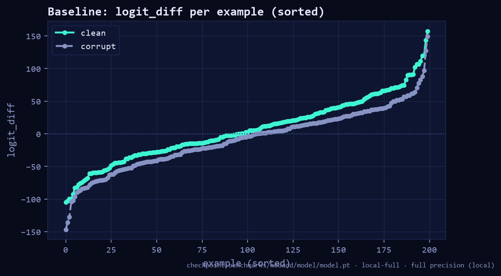

# modadd (task-shuffled labels): no behaviour to explain

**Behavior:** 1-layer transformer, input [a, b, =], claimed to output (a + b) mod 113 at the last position. Dataset task 'modadd'.  
**Model:** `checkpoint:benchmarks/modadd/model/model.pt` on `local-full`  
**Status:** unverified (no verification run) · null result: behaviour absent as scored  
**Experiments run:** 3 · **Backends used:** full precision (local)  
**Written:** 2026-11-13 12:10

## Summary

Against the labels this investigation is scored with, the model is at chance: top-1 accuracy 0.0087 on the full 113x113 grid (E0002) and 0.010 on a 200-pair sample (E0003); chance is 1/113 = 0.0088. Both pre-registered predictions of >=95% accuracy were refuted. Per protocol the investigation stopped after the baseline: there is no mechanism to explain, no algorithm was written and no verification was run. All numbers are from local-full (full precision). 3 of 40 experiments used.

## The recovered algorithm

```python
# No algorithm recovered.
# The model's output is unrelated to the scored labels (accuracy = chance, E0002, E0003),
# so there is no input->label computation to describe.
```

## Claims and evidence

| # | Claim | Evidence | Produced by |
|---|---|---|---|
| 1 | On the full 113x113 grid the model's top-1 accuracy against the scored labels is 0.0087, indistinguishable from chance (1/113 = 0.0088); mean logit difference is 0.07 with std 47 (local-full). | E0002 | full precision (local) |
| 2 | The chance-level result is not specific to the full grid: on a 200-pair sample accuracy is 0.010 (local-full). | E0003 | full precision (local) |
| 3 | The labels used for scoring differ from the answers the dataset primitive displays for the same prompts: the first four prompts show answers 38, 97, 57, 103 in E0001 but are scored against 65, 41, 92, 1 in E0003. | E0001, E0003 | full precision (local) |
| 4 | The model is confident rather than uninformative: logit differences between the two scored labels have std 47-50 around a mean near zero, i.e. the model puts large logits on tokens that are unrelated to the scored labels. | E0002, E0003 | full precision (local) |

## Key plots

**E0002: baseline** (full precision (local))



**E0003: baseline** (full precision (local))



## Limitations

- No mechanism experiments were run: with scored labels unrelated to the model's output, every patching or ablation metric would be noise.
- No verify_hypothesis run: there is no algorithm to verify.
- The 8 example predictions shown by the baseline runs (0,1,2,3 in E0002; 38,97,57,103 in E0003) all equal true (a+b) mod 113. This is an observation on 8 examples, not a measured accuracy, and was not tested further because the investigation's task is defined by the scored labels.

## Open questions

- Does the model compute true (a+b) mod 113 at high accuracy when scored against unshuffled labels? The 8 example predictions suggest so; this needs a baseline with the unshuffled task, which is a separate investigation.
- Why does the dataset primitive display answers that differ from the labels the baseline scores against?

## Prediction record

2 experiments were pre-registered, 2 were run: **0 confirmed, 2 refuted, 0 inconclusive**. Hit rate (confirmed / decided): **0%**.

Refuted predictions (shown, not hidden):

| prereg | experiment | hypothesis | predicted | observed |
|---|---|---|---|---|
| N0003 | E0002 | The model computes (a+b) mod 113 at the last position with high accuracy on the full grid. | `summary.clean_accuracy >= 0.95` | 0.009 |
| N0006 | E0003 | On a sampled dataset (n=200, seed 0), whose labels in E0001 matched true (a+b) mod 113, the model scores high accuracy; the chance result in E0002 is specific t | `summary.clean_accuracy >= 0.95` | 0.010 |

## Experiments

| id | primitive | backend / precision | seconds | pre-registration |
|---|---|---|---|---|
| E0001 | dataset | full precision (local) | 0.01 | exploratory |
| E0002 | baseline | full precision (local) | 0.97 | N0003: refuted |
| E0003 | baseline | full precision (local) | 0.11 | N0006: refuted |

## Notebook trail

- `N0001` *decision*: Loaded checkpoint:benchmarks/modadd/model/model.pt on local-full (full precision (local)).
- `N0002` *experiment*: dataset (E0001)
- `N0003` *prereg*: The model computes (a+b) mod 113 at the last position with high accuracy on the full grid.
- `N0004` *experiment*: The model computes (a+b) mod 113 at the last position with high accuracy on the full grid. (E0002)
- `N0005` *result*: Baseline on full grid (n=all, local-full): clean_accuracy 0.0087 = chance (1/113 = 0.0088); mean logit diff 0.07 +/- 47. Prediction N0003 (>=0.95) REFUTED. Against the labels the lab scores with, the model does not do the stated behaviour. Observation: the first four example predictions are 0,1,2,3 while expected labels are 11,72,42,48; the large logit-diff std (47) shows the model is confident, just not about these labels. The E0001 sample (n=16) had labels equal to true (a+b) mod 113, so one follow-up baseline on a sampled dataset checks whether the mismatch is specific to the n=all labels. (E0002)
- `N0006` *prereg*: On a sampled dataset (n=200, seed 0), whose labels in E0001 matched true (a+b) mod 113, the model scores high accuracy; the chance result in E0002 is specific to the labels of the n=all grid.
- `N0007` *experiment*: On a sampled dataset (n=200, seed 0), whose labels in E0001 matched true (a+b) mod 113, the model scores high accuracy;  (E0003)
- `N0008` *result*: Baseline on n=200 seed 0 (local-full): clean_accuracy 0.010 = chance; logit diff 6.4 +/- 49.6. Prediction N0006 (>=0.95) REFUTED. The scored labels differ from the labels displayed by the dataset primitive: E0001 showed answers 38,97,57,103 for the first four prompts (= true (a+b) mod 113), E0003 scored the same prompts against 65,41,92,1, while the model predicted 38,97,57,103. So the labels this investigation is scored against are unrelated to the model's outputs on both the full grid and a sample. All 8 displayed example predictions (4 in E0002, 4 in E0003) equal true (a+b) mod 113, but that is 8 examples, not a measured accuracy. (E0003, E0002, E0001)
- `N0009` *decision*: STOP per protocol step 1: against the labels this investigation's task is scored with, accuracy is at chance (0.0087 on 12769 pairs, 0.010 on 200). There is no mechanism to explain for the behaviour as scored; any patching/ablation metric would be a logit difference between two labels that are both unrelated to the model's output, so circuit results would be noise. Not running mechanism experiments, not running verify_hypothesis (no algorithm to verify), and not substituting my own labels to route around the scored task. 3 of 40 experiments used. Reporting the null result. (E0002, E0003)
