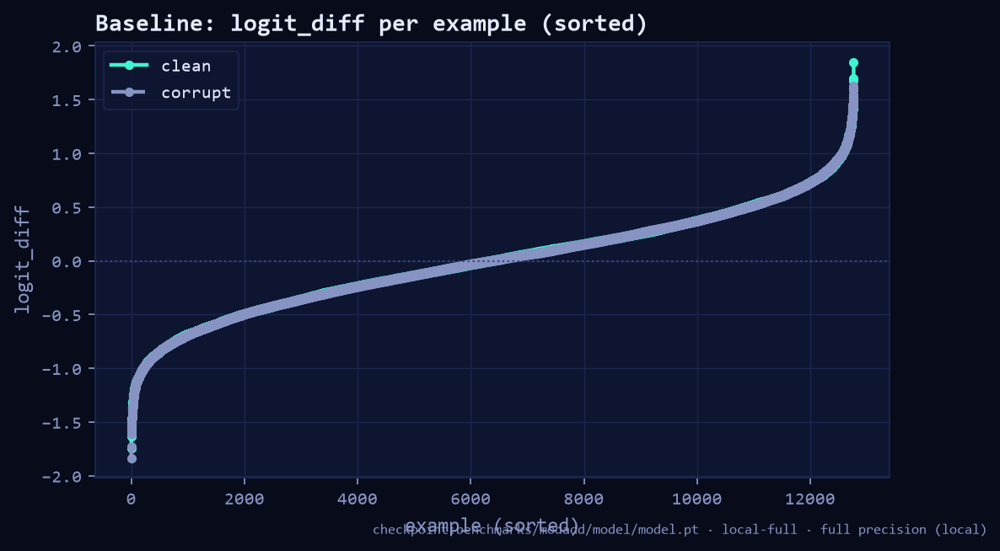

# Modular addition (null: weight-shuffled): the model does not perform the behaviour

**Behavior:** Claimed: input [a, b, =] with a, b in 0..112, output (a + b) mod 113 at the last position. Checkpoint: benchmarks/modadd/model/model.pt on local-full (full precision), 1 layer, 4 heads, d_model 128, d_mlp 512.  
**Model:** `checkpoint:benchmarks/modadd/model/model.pt` on `local-full`  
**Status:** unverified (no verification run) · no behaviour - nothing to explain  
**Experiments run:** 2 · **Backends used:** full precision (local)  
**Written:** 2026-11-13 12:09

## Summary

The loaded checkpoint does not compute (a + b) mod 113. On the full 113x113 grid its accuracy is 0.92% (117 of 12769), which is chance level (1/113 = 0.885%), and the mean logit difference between the correct answer and a wrong answer is -0.003 (std 0.475), the same as on corrupted inputs (-0.005). The pre-registered prediction that accuracy would be at least 95% was refuted. Following the protocol, the investigation stopped after the baseline: with no behaviour there is no mechanism to recover, and no algorithm is claimed. No verification was run because there is nothing to verify.

## The recovered algorithm

```python
# No algorithm recovered: the model's output is unrelated to (a + b) mod 113 (E0002).
# No predict() function is claimed.
```

## Claims and evidence

| # | Claim | Evidence | Produced by |
|---|---|---|---|
| 1 | On the full 113x113 grid the model's accuracy at predicting (a + b) mod 113 is 0.009163, at chance (1/113 = 0.00885); full precision, local-full. | E0002 | full precision (local) |
| 2 | The mean logit difference (correct minus incorrect answer) is -0.003 with std 0.475, indistinguishable from the corrupted-input mean of -0.005: the model carries no measurable preference for the correct answer. | E0002 | full precision (local) |

## Key plots

**E0002: baseline** (full precision (local))



## Limitations

- Only the baseline was run (2 of 40 experiments, one of them the dataset inspection). No screening, patching, ablation or weight analysis was done, by design: at chance accuracy, any structure they turned up could not be attributed to the task.
- The baseline says the model does not do modular addition; it does not say what, if anything, the model does compute instead. The first example predictions repeat one token (63) for several inputs, which was not followed up.
- No verify_hypothesis run: there is no hypothesis about a mechanism to verify.

## Open questions

- Is the checkpoint path in the request the intended one? The investigation name says 'null-weight-shuffled', and the result is consistent with a model whose weights do not implement the task, but that was not tested here beyond the baseline.
- Would weight-level analyses (periodicity, weights_svd) show any residual structure in this checkpoint? Not measured.

## Prediction record

1 experiments were pre-registered, 1 were run: **0 confirmed, 1 refuted, 0 inconclusive**. Hit rate (confirmed / decided): **0%**.

Refuted predictions (shown, not hidden):

| prereg | experiment | hypothesis | predicted | observed |
|---|---|---|---|---|
| N0003 | E0002 | The model performs (a+b) mod 113 at the last position on the full grid, as stated in the task. | `summary.clean_accuracy >= 0.95` | 0.009 |

## Experiments

| id | primitive | backend / precision | seconds | pre-registration |
|---|---|---|---|---|
| E0001 | dataset | full precision (local) | 0.0 | exploratory |
| E0002 | baseline | full precision (local) | 0.84 | N0003: refuted |

## Notebook trail

- `N0001` *decision*: Loaded checkpoint:benchmarks/modadd/model/model.pt on local-full (full precision (local)).
- `N0002` *experiment*: dataset (E0001)
- `N0003` *prereg*: The model performs (a+b) mod 113 at the last position on the full grid, as stated in the task.
- `N0004` *experiment*: The model performs (a+b) mod 113 at the last position on the full grid, as stated in the task. (E0002)
- `N0005` *result*: Baseline on the full 113x113 grid (local-full, full precision): accuracy 0.009163 (117/12769), chance is 1/113 = 0.00885. Mean logit diff -0.003 (std 0.475), indistinguishable from the corrupt mean -0.005. Pre-registered prediction (accuracy >= 0.95) REFUTED. The loaded checkpoint does not perform modular addition; the hypothesis 'the model computes (a+b) mod 113' is rejected for this checkpoint. (E0002)
- `N0006` *decision*: Stop per step 1 of the protocol: the behaviour is absent (accuracy at chance), so there is no mechanism to explain. No screening, mechanism or verify_hypothesis runs will be made; any circuit found by further experiments would be structure in noise. Report as 'no behaviour / null'. 2 of 40 experiments used.
