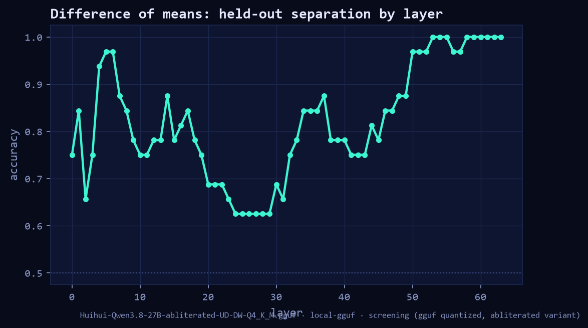
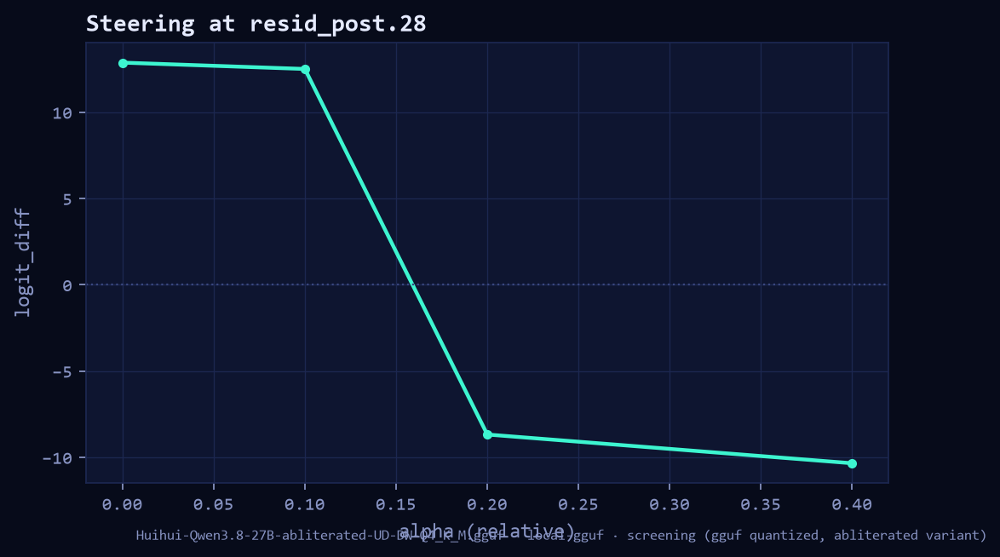
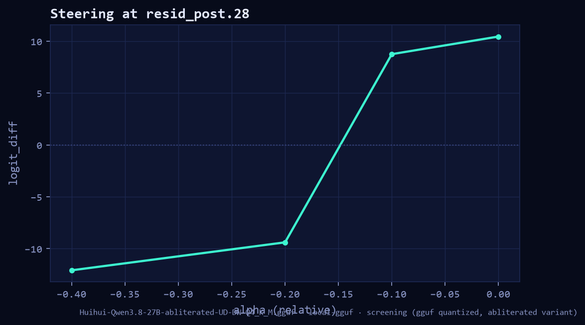
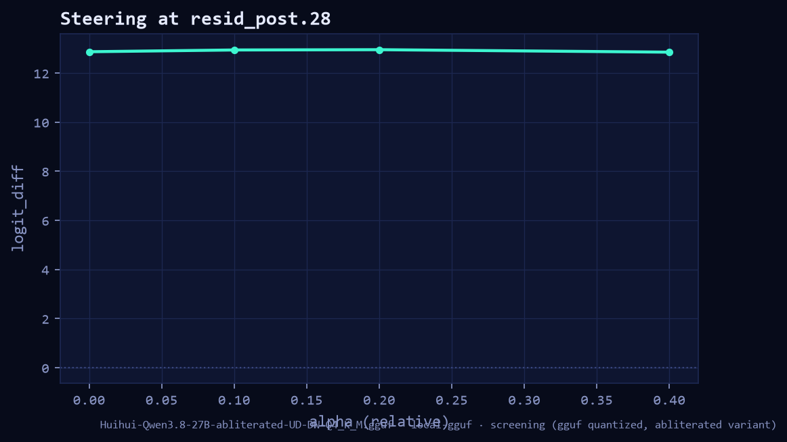
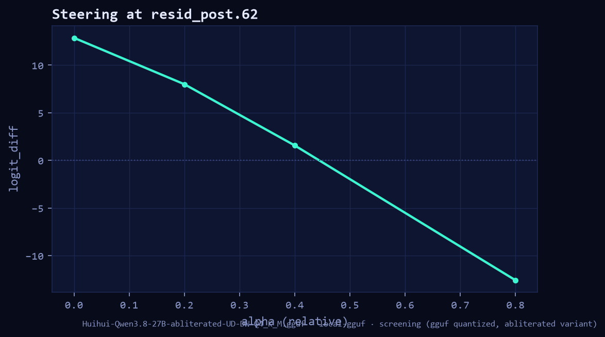

# Continuation language in Huihui-Qwen3.8-27B-abliterated (Q4_K_M GGUF): one steerable direction, effective from layer 6 to about layer 58

**Behavior:** The model continues plain text in the language the text is written in: English sentence beginnings get English continuations, French ones get French continuations. Tested on hand-written prompts: 32 EN + 32 FR translation pairs for extraction, plus two further unseen sets (8+8 and 12+12) for testing. No chat template.  
**Model:** `Huihui-Qwen3.8-27B-abliterated-UD-DW-Q4_K_M.gguf` on `local-gguf`  
**Status:** unverified (no verification run) · SCREENING ONLY - quantized (Q4_K_M, about 4.8 bpw), abliterated community variant, llama.cpp - not verified  
**Experiments run:** 16 · **Backends used:** screening (gguf quantized, abliterated variant)  
**Written:** 2026-11-12 23:46

## Summary

All numbers come from the local-gguf backend on a quantized, abliterated variant, so everything here is a screening result. Nothing was verified at full precision and verify_hypothesis could not run on this data (it needs position-aligned inputs and this backend cannot ablate or patch).

What was found. (1) The behaviour is there: the prompt-language article beats the other-language article on 64/64 prompts, mean logit difference 11.9 (E0001). (2) Language is linearly readable at every layer including layer 0, so a probe cannot localise it (E0002). (3) The mean difference between French and English last-token activations gives one direction per layer. Along it the two languages separate moderately in layers 4-18, poorly in layers 21-33, and very cleanly in layers 50-63 (E0003). (4) That read-out profile does not predict where steering works. Adding the direction at layer 6, 28, 54 or 58, at 0.4 to 0.45 of the residual norm, turns English prompts into French continuations on 8/8 prompts each time, and layer 28, the worst layer for read-out, flips at the lowest dose (E0005, E0006, E0007, E0016). At layer 62 the same direction only produces 'la la la' (E0013), as does a 10x overdose at layer 54 (E0004). (5) Subtracting it turns French prompts into English continuations, 8/8 (E0008). (6) A control direction of the same size, built the same way from a language-balanced split, changes nothing (E0009, E0010). (7) The effect holds on two prompt sets never used to build the direction, with different topics and stopping points: 8/8 and 12/12 in each direction (E0011, E0012, E0014, E0015).

Answer to the question. Yes, there is a direction for the continuation language, and it is causal in both directions in this model variant. There is no narrow layer where it lives: a push anywhere from layer 6 to about layer 58 is picked up and turned into a coherent continuation in the other language, while in the last few layers (62) the direction has become a push on specific output tokens. Two predictions of mine were wrong and are kept in the notebook: that the separation would peak in the middle layers, and that steering would work best where separation is cleanest.

## The recovered algorithm

```python
def predict(tokens, prompt):
    # Behavioural rule only. Screening evidence, quantized abliterated variant.
    # E0001: next token is in the prompt's language (64/64).
    # E0006/E0008/E0011/E0012/E0014/E0015: which language is set by the sign of the
    #   residual stream along one direction d (A0002_diffmeans = mean_FR - mean_EN).
    lang = 'fr' if project(resid, d) > threshold else 'en'   # read-out reliable only late (E0003)
    # steering: resid += alpha * |resid| * d_hat at any layer 6..58, alpha ~ +0.4 -> 'fr', -0.4 -> 'en'
    #   (E0005-E0008, E0016); at layer 62 this only biases the token ' la' (E0013)
    return next_word_in(lang, context=prompt)   # content is kept, language is swapped (E0012, E0014)
```

## Circuit


## Claims and evidence

| # | Claim | Evidence | Produced by |
|---|---|---|---|
| 1 | SCREENING (local-gguf, Q4_K_M, abliterated). The model does the behaviour: logit of the prompt-language article minus the other-language article is positive on 64/64 prompts, mean 11.88, min 7.16. | E0001 | screening (gguf quantized, abliterated variant) |
| 2 | SCREENING. Language is linearly decodable at the last token at every layer (held-out probe accuracy 0.80-1.0, already 1.0 at layer 0), so probing does not localise the continuation language. The shuffled-label control is noisy with 20 test items (0.15-0.95). | E0002 | screening (gguf quantized, abliterated variant) |
| 3 | SCREENING. Along the single FR-minus-EN mean-difference direction, held-out separation is moderate in layers 4-18 (d' 2-3), weak in layers 21-33 (d' 0.77-1.1, accuracy 0.63-0.69) and strong in layers 50-63 (d' 3.4 to 14.6, accuracy 0.97-1.0). In early and middle layers the language mean difference is no longer than an arbitrary sentence-set mean difference (L28: 14.5 vs 15.9); late it is much longer (L63: 411 vs 121). | E0003, E0009 | screening (gguf quantized, abliterated variant) |
| 4 | SCREENING. Adding the direction to English prompts gives French continuations on 8/8 prompts at layers 6, 28, 54 (alpha 0.4 of the residual norm) and 58 (alpha 0.45), with the metric going from +12.9 to between -9.5 and -10.7. Layer 28 flips at the lowest relative dose (already -8.7 at alpha 0.2, where layers 6 and 54 are still at +7). At layer 58 two of eight outputs are degraded (a loop and a nonsense sentence). | E0005, E0006, E0007, E0016 | screening (gguf quantized, abliterated variant) |
| 5 | SCREENING. Subtracting the direction from French prompts at layer 28 gives English continuations on 8/8 prompts; metric +10.5 to -12.1, with the same flip threshold as the forward direction (between |alpha| 0.1 and 0.2). | E0008 | screening (gguf quantized, abliterated variant) |
| 6 | SCREENING. The effect is specific to this direction: a control direction of the same relative size, built from a language-balanced split of the same prompts, leaves the metric unchanged (+12.87 to +12.85) and the text English on 8/8. | E0009, E0010 | screening (gguf quantized, abliterated variant) |
| 7 | SCREENING. The direction is a language direction and not only an 'article comes next' direction: on prompts never used to build it, with other topics and stopping points, layer-28 steering switches the language on 8/8 and 12/12 prompts EN to FR and 8/8 and 12/12 FR to EN, often keeping the content ("ma mère me disait toujours que" -> " I should eat my vegetables."). | E0011, E0012, E0014, E0015 | screening (gguf quantized, abliterated variant) |
| 8 | SCREENING. Near the output the direction is token-level: at layer 62 a dose of about 1.1x the EN-FR distance gives ' la la la ...' on 6/8 prompts and no coherent French on any, and a 10x overdose at layer 54 gives the same. The upper edge of the range where steering switches the language lies between layers 58 and 62. | E0013, E0004, E0016 | screening (gguf quantized, abliterated variant) |
| 9 | SCREENING. Steering has a side effect on text genre: 11/12 steered French-to-English outputs fall into a multiple-choice quiz format versus 1/12 unsteered. | E0015 | screening (gguf quantized, abliterated variant) |
| 10 | Rejected predictions, kept for the record: (a) that single-direction separation would peak in the middle layers (it is weakest there, E0003); (b) that steering would work best where separation is cleanest and worst in the trough (the trough layer 28 is the most sensitive, E0006 vs E0005 and E0007). | E0003, E0005, E0006, E0007 | screening (gguf quantized, abliterated variant) |

## Key plots

**E0003: diff_of_means** (screening (gguf quantized, abliterated variant))



**E0006: steering** (screening (gguf quantized, abliterated variant))



**E0008: steering** (screening (gguf quantized, abliterated variant))



**E0010: steering** (screening (gguf quantized, abliterated variant))



**E0013: steering** (screening (gguf quantized, abliterated variant))



## Limitations

- Screening only: every number is from a Q4_K_M quantized, abliterated community variant run through llama.cpp. Nothing was checked on the official weights or at full precision.
- No formal verification: verify_hypothesis failed twice on token-length alignment and produced no V-id. The held-out replications (E0011, E0012, E0014, E0015) are a substitute, not a verification.
- No patching or ablation on this backend, so necessity was not tested. The results show the direction is sufficient to switch the language, not that the model needs it or that it is the only such direction.
- Steering is added at every token position and an early push travels through all later layers. 'Works from layer 6' therefore means the model can pick the language up downstream of layer 6, not that the language is decided there. The edges in the diagram between bands are inferred from this, not measured.
- Layer coverage is five points (6, 28, 54, 58, 62). Layers below 6, between these points, and 59-61 were not tested. Layer 62 was read at one dose only.
- Whether generated text is French or English, and whether it is coherent, was judged by reading it; there is no automatic language classifier in the loop. Samples are small (8 or 12 prompts per condition), greedy-looking continuations of 20 tokens.
- The tool prints generated text only for the largest alpha in a run, so dose-response for text is known at one dose per run; the dose-response curves are for the article logit metric only.
- The logit metric uses one token pair (' the' vs ' la'). At high dose or at layer 62 the metric flips while the text is degenerate, so the metric alone overstates success.
- The direction was extracted at the last token of sentences ending before an article, from 32 pairs. Only one control direction was tested, at one layer, in one steering direction.
- Only English and French. Nothing here says the same direction handles other languages.
- Steered text drifts toward a multiple-choice quiz format (11/12 vs 1/12 in E0015), so the direction is not purely about language.
- Alpha is relative to the residual norm, so the same alpha is a different multiple of the EN-FR distance at each layer (about 3x at L6, 2.4x at L28, 1x at L54). Layer comparisons depend on which unit is used.

## Open questions

- Does the same direction and layer range hold on the official Qwen3.8-27B weights at full precision (ndif or local-full)? That is the run that could verify this.
- Is the direction necessary? Projecting it out or patching it between an English and a French prompt needs a patching backend.
- Why is the middle band the most sensitive to steering while being the worst for read-out along the same direction?
- Where exactly does the direction turn from 'language' into 'output token' between layers 58 and 62, and where is the lower edge below layer 6?
- Is it one EN-FR axis or a general language space? Test with a third language.
- Is the quiz-format drift part of the direction or a property of the extraction prompts?

## Experiments

| id | primitive | backend / precision | seconds |
|---|---|---|---|
| E0001 | baseline | screening (gguf quantized, abliterated variant) | 9.51 |
| E0002 | linear_probe | screening (gguf quantized, abliterated variant) | 14.34 |
| E0003 | diff_of_means | screening (gguf quantized, abliterated variant) | 10.8 |
| E0004 | steering | screening (gguf quantized, abliterated variant) | 27.34 |
| E0005 | steering | screening (gguf quantized, abliterated variant) | 30.79 |
| E0006 | steering | screening (gguf quantized, abliterated variant) | 30.52 |
| E0007 | steering | screening (gguf quantized, abliterated variant) | 30.32 |
| E0008 | steering | screening (gguf quantized, abliterated variant) | 31.37 |
| E0009 | diff_of_means | screening (gguf quantized, abliterated variant) | 10.73 |
| E0010 | steering | screening (gguf quantized, abliterated variant) | 30.75 |
| E0011 | steering | screening (gguf quantized, abliterated variant) | 30.02 |
| E0012 | steering | screening (gguf quantized, abliterated variant) | 29.72 |
| E0013 | steering | screening (gguf quantized, abliterated variant) | 30.22 |
| E0014 | steering | screening (gguf quantized, abliterated variant) | 43.29 |
| E0015 | steering | screening (gguf quantized, abliterated variant) | 43.47 |
| E0016 | steering | screening (gguf quantized, abliterated variant) | 29.52 |

## Notebook trail

- `N0001` *decision*: Loaded Huihui-Qwen3.8-27B-abliterated-UD-DW-Q4_K_M.gguf on local-gguf (screening (gguf quantized)).
- `N0002` *hypothesis* **[supported]**: H1 (behaviour exists): On 32 English + 32 French sentence beginnings (translation pairs, different topics, plain text, each ending on a preposition so an article is a natural next word), the model's next-token logits favour the prompt's language: logit(" the") - logit(" la") > 0 on English prompts and < 0 on French prompts. Counts against: mean logit diff near 0 or accuracy near 50%, in which case the behaviour is not present on this metric and I stop or change metric. Backend: local-gguf Q4_K_M abliterated = screening only.
- `N0003` *experiment*: H1: does the model prefer the prompt-language article? 32 EN then 32 FR prompts. (E0001)
- `N0004` *result*: E0001 (local-gguf, Q4_K_M abliterated, screening): the logit diff (prompt-language article minus other-language article, " the" vs " la") is positive on all 64 prompts (min 7.16, mean 11.88, std 1.85). Top-1 is exactly the expected article on 67% (misses are other same-language words such as " a"). H1 supported: the model does the behaviour on this metric. (E0001)
- `N0005` *hypothesis* **[supported]** -> N0002: Supported by E0001: language-correct logit diff > 0 on 64/64 prompts, mean 11.9 (screening, quantized abliterated variant).
- `N0006` *hypothesis* **[supported]**: H2 (where, read-out): the language (EN vs FR) is linearly decodable from the residual stream at the last token position at essentially every layer after the first few (held-out probe accuracy near 1.0, shuffled-label control near 0.5). Counts against: probe accuracy near the control in a broad layer range. Note in advance: a probe that is perfect everywhere cannot localise anything by itself (the input tokens themselves differ by language), so the layer range must come from where the EN-FR difference is large relative to the activations (diff_of_means) and from where steering works (causal).
- `N0007` *experiment*: H2: per-layer held-out probe for language (0=EN, 1=FR) at the last token. (E0002)
- `N0008` *result*: E0002 (local-gguf, screening): language probe at the last token, 44 train / 20 test. Held-out accuracy 0.95-1.0 at layers 0-24 and 33-63, with a dip to 0.80-0.90 at layers 25-32. Already 1.0 at resid_post.0, so the probe is reading token identity ("of" vs "de") and does not localise anything, as anticipated. Shuffled-label control averages around 0.5 but is very noisy with 20 test items (range 0.15-0.95, one control at layer 57 reached 0.95), so differences of 1-3 test items (including the 25-32 dip) are within noise. H2 supported as stated, but it is uninformative about where the continuation language is controlled. (E0002)
- `N0009` *hypothesis* **[supported]** -> N0006: Supported by E0002 (decodable at every layer, >=0.8 everywhere, 1.0 from layer 0) but uninformative for localisation: token identity already separates the languages. Localisation must come from steering.
- `N0010` *hypothesis* **[revised]**: H3 (direction): the mean difference FR minus EN of the last-token residual stream gives one direction per layer that separates the two languages cleanly (projections of the two groups do not overlap) and whose size relative to the residual norm peaks in a middle band of layers. Counts against: overlapping projections, or no layer structure at all in the separation. This is still correlational; H4 (steering) is the causal test.
- `N0011` *experiment*: H3: FR (positive) minus EN (negative) direction per layer. (E0003)
- `N0012` *result*: E0003 (local-gguf, screening): FR-minus-EN mean difference at the last token, per layer (artifact A0002_diffmeans). Three regimes in held-out separation along that single direction: (a) layers 4-18: d' about 2-3, accuracy 0.75-0.97 (peak 0.97 at layers 5-6); (b) layers 21-33: a trough, d' 0.77-1.1, accuracy 0.63-0.69, i.e. the mean-difference direction barely separates the languages here; (c) layers 50-63: sharp rise, d' 3.4 at L50, 5.1 at L54, 14.6 at L62, accuracy 0.97-1.0. Direction norm relative to the residual grows from 0.10-0.13 (layers 1-16) to 0.16-0.24 (18-49) to 0.32-0.77 (50-63). Contrast with E0002: a trained probe still gets 0.8-0.9 in the trough, so language information is present there but not along the mean-difference axis. (E0003)
- `N0013` *hypothesis* **[revised]** -> N0010: Revised after E0003. A separating direction exists, but my prediction of a middle-band peak was wrong: the middle (layers 21-33) is where the single-direction separation is WEAKEST (d' < 1.1), and the clean, non-overlapping separation is in the late layers 50-63 (d' 3.4 to 14.6). Early layers 4-18 separate moderately (d' 2-3).
- `N0014` *hypothesis* **[revised]**: H4 (causal, layer range): adding the FR-minus-EN direction (A0002_diffmeans) to the residual stream switches the continuation language, and it does so best in the late band where E0003 shows clean separation (around layer 54), less in the early band (around layer 6) and least in the trough (around layer 28). Test: same 8 English prompts, same alphas, one site per experiment at L54, L28, L6; metric logit(" the") - logit(" la") plus generated text. Supports: metric goes from about +12 to negative and generated text becomes French at a moderate alpha. Counts against: metric stays positive at every alpha, or text turns to garbage rather than French, or the trough layer works as well or better than the late layer (then E0003's separation profile does not predict causal efficacy). Then H5: steering French prompts with negative alpha gives English; and a control direction must NOT do this.
- `N0015` *experiment*: H4: steer 8 EN prompts along FR-EN direction at resid_post.54 (late band). (E0004)
- `N0016` *result*: E0004 (local-gguf, screening): steering 8 EN prompts along A0002_diffmeans at resid_post.54. Alpha is RELATIVE to the residual norm at the site (201.3 at L54; the FR-EN difference itself is 0.38-0.41 of that norm per E0003, so alpha 0.4 is about one EN-to-FR mean shift). Metric logit(" the")-logit(" la"): +12.87 at alpha 0, -11.77 at 0.5, -16.05 at 1, -17.02 at 2, -16.76 at 4. So the logit preference flips fully already at alpha 0.5. BUT the generated text at alpha 4 (the only steered alpha the tool printed) is " la la la la la ..." on all 8 prompts: not French, a degenerate repetition of the one token in my metric. Two readings: (i) alpha 4 is simply a 4x-residual-norm overdose; (ii) the late-layer direction is a "next token is la" direction rather than a language direction, because every prompt in my set ends right before an article. The metric cannot tell these apart; only generated text at moderate alpha can. Unsteered generations are all English (e.g. " the oven and pulled out the bread."). (E0004)
- `N0017` *decision*: The tool prints generated text only for alpha 0 and the largest alpha. So each steering run gets one informative generation: the top alpha must be the moderate dose I want to read. Next three runs: same 8 EN prompts, alphas [0, 0.1, 0.2, 0.4], one site each at L54 (late), L28 (trough), L6 (early). Judge by text first (fluent varied French = language switch; "la la la" or English = not), metric second. Prediction under H4: L54 gives French text at 0.4; under reading (ii) of E0004 it gives article repetition.
- `N0018` *experiment*: H4: EN prompts, L54 late band, moderate dose (text at alpha 0.4). (E0005)
- `N0019` *experiment*: H4: EN prompts, L28 trough, same alphas. (E0006)
- `N0020` *experiment*: H4: EN prompts, L6 early band, same alphas. (E0007)
- `N0021` *result*: E0005/E0006/E0007 (local-gguf, screening): same 8 EN prompts, direction A0002_diffmeans, alpha relative to residual norm, one site per run. Metric logit(" the")-logit(" la") at alpha 0 / 0.1 / 0.2 / 0.4:
- L54 (E0005): +12.87 / +12.17 / +7.21 / -10.66
- L28 (E0006): +12.87 / +12.50 / -8.68 / -10.35
- L6  (E0007): +12.87 / +12.78 / +7.63 / -9.50
Generated text at alpha 0.4 is French on 8/8 prompts at every one of the three layers, and it is real French that fits the English prompt's content, not article repetition: e.g. "The fishermen came back from" -> L54 " la mer avec des poissons." / L28 " la mer avec une pêche miraculeuse." / L6 " la mer avec leurs filets pleins de poissons."; "The farmer walked slowly toward" -> L28 " la maison, les mains dans les poches, le regard perdu dans le lointain. Il"; "The thief hid the money in" -> L6 " un endroit où il ne serait pas facile de la trouver." First words vary (la, le, les, un, une, son, leucémie), so reading (ii) of E0004 (a pure " la" token direction) is rejected at moderate dose; the "la la la" of E0004 was an overdose (alpha 4). Minor leaks: L28 once produced mixed text ("The user is asking de compléter une phrase en français"), and one option list at L28 had an English word ("A. park").
Layer comparison: all three bands work at the same relative alpha; the trough layer L28 flips at the LOWEST dose (already at 0.2). In units of each layer's own EN-FR distance, alpha 0.4 is about 1.0x at L54, 2.4x at L28, 3.1x at L6 (from the relative norms in E0003). (E0005, E0006, E0007)
- `N0022` *hypothesis* **[revised]** -> N0014: Revised after E0005-E0007. Supported part: adding the FR-minus-EN direction switches the continuation to fluent French (8/8 prompts) with the logit metric going from +12.9 to about -10. Rejected part: the layer ordering. I predicted late (L54) > early (L6) > trough (L28). Measured: all three work at relative alpha 0.4 and L28 flips at the lowest relative dose (0.2). So E0003's single-direction separation profile does NOT predict causal efficacy, and steering does not give a narrow layer range: the direction is causally effective from at least layer 6 through layer 54. Caveat: llama.cpp control vectors are added at all positions and an early-layer push propagates through all later layers, so 'works at L6' means 'the model can pick the language up downstream of L6', not 'the language is decided at L6'. Still missing: specificity (a control direction of equal size) and the reverse direction (FR -> EN).
- `N0023` *hypothesis* **[supported]**: H5 (reverse): steering 8 FRENCH prompts AGAINST the direction (negative alpha, same sizes) at L28 flips the metric logit(" la")-logit(" the") from positive to negative and gives English continuations. Counts against: French text persists at alpha -0.4, or the text degenerates. H6 (specificity): a control direction of the same relative size (0.4) at L28 on the English prompts does NOT flip the metric and leaves the text English. Counts against the whole 'language direction' reading: the control also produces French or flips the metric, which would mean any large perturbation does it.
- `N0024` *experiment*: H5: 8 FR prompts steered AGAINST the FR-EN direction at L28. (E0008)
- `N0025` *result*: E0008 (local-gguf, screening): 8 FR prompts steered against A0002_diffmeans at resid_post.28. Metric logit(" la")-logit(" the") at alpha 0 / -0.1 / -0.2 / -0.4: +10.46 / +8.76 / -9.39 / -12.08. Generated text at -0.4 is English on 8/8, content-appropriate: "Les pêcheurs sont revenus de" -> unsteered " la mer avec un beau lot de poissons." / steered " the sea with a good catch."; "Le voleur a caché l'argent dans" -> " un trou." / " a hole in the wall."; "Le fermier marchait lentement vers" -> " la maison, sa silhouette se découpant sur le ciel crépusculaire." / " the barn." H5 supported. Same threshold as the forward direction at L28 (flip between |alpha| 0.1 and 0.2), so the effect is roughly symmetric. Observation: steered text more often falls into a multiple-choice quiz format (A./B./C.) than unsteered text, so steering is not perfectly clean. (E0008)
- `N0026` *decision*: The steering tool has no random-direction option (two attempts errored without running; no experiment id, no budget used). Workaround for the specificity control H6: build a control direction the same way as the language direction but from a language-BALANCED arbitrary split: positive = sentence pairs 1-16 in both EN and FR (32 prompts), negative = pairs 17-32 in both languages (32 prompts). This is a mean difference of real activations with no language content. Then steer the same 8 EN prompts with it at L28, same relative alphas. Costs 2 experiments. Prediction under H6: metric stays clearly positive and text stays English at alpha 0.4.
- `N0027` *experiment*: H6 control direction: language-balanced arbitrary split (pairs 1-16 vs 17-32, both languages on each side). (E0009)
- `N0028` *experiment*: H6: control direction A0003 (language-balanced split) at L28 on the same 8 EN prompts, same alphas. (E0010)
- `N0029` *result*: E0009 + E0010 (local-gguf, screening): specificity control. E0009 built a control direction (A0003_diffmeans) from a language-balanced split of the same 64 prompts (pairs 1-16 vs 17-32, both languages each side). E0010 steered the same 8 EN prompts with it at resid_post.28 at the same relative alphas: metric +12.87 / +12.94 / +12.95 / +12.85 at alpha 0 / 0.1 / 0.2 / 0.4 (no change), generated text English on 8/8 (e.g. " the sea with their catch. The fish were still alive and wriggling in the nets."). Compare E0006: language direction, same layer, same dose -> -10.35 and French 8/8. H6 supported: an equally large push in a non-language direction does nothing to the language; the effect is specific to the FR-EN direction.
Side finding from E0009 vs E0003: at L28 the control mean-difference is as long as the language one (norm 15.9 vs 14.5; relative 0.186 vs 0.170), and at L6 nearly so (3.29 vs 3.76). Only late does the language difference stand out (L54: 69.3 vs 46.1; L63: 411 vs 121). So in early and middle layers the language mean-difference is no bigger than an arbitrary sentence-set difference, which explains the low d' in the trough, yet it still carries the causally effective component. (E0009, E0010, E0006, E0003)
- `N0030` *hypothesis* **[supported]**: H7 (generalisation, held-out prompts): the direction was built only from the last token of sentences that stop right before an article. If it is a language direction and not an 'article in French comes next' direction, it must also switch the language on 8 NEW prompts with different topics and different syntactic stopping points (after 'because', 'that', 'is', a verb, an auxiliary), in both directions (EN +0.4 -> French; FR -0.4 -> English) at L28. Counts against: text stays in the prompt language on most of the new prompts, or becomes ungrammatical. H8 (late edge): at L62, two layers before the output, the same direction at a moderate dose changes surface tokens but I expect less coherent French than at L28 (too late for the rest of the network to plan a French sentence). Counts against: fluent content-appropriate French at L62 too, which would mean the effective range runs to the very end.
- `N0031` *experiment*: H7: held-out EN prompts (new topics, varied stopping points), +direction at L28. (E0011)
- `N0032` *experiment*: H7: held-out FR prompts, against the direction at L28. (E0012)
- `N0033` *experiment*: H8: late edge, L62, original 8 EN prompts; alpha 0.8 is about 1.1x the EN-FR distance at this layer. (E0013)
- `N0034` *result*: E0011/E0012 (local-gguf, screening): held-out prompts never used to build the direction, new topics, stopping after 'because', 'that', 'is', a verb, an auxiliary. Site resid_post.28.
- E0011, EN + direction: metric logit(" the")-logit(" la") +8.71 / -5.96 / -8.82 at alpha 0 / 0.2 / 0.4; text at 0.4 French on 8/8. "My favourite season is autumn because" -> " it is cool and the leaves change colour." becomes " c'est la saison des couleurs. Les feuilles changent de couleur, passant du vert au jaune,"; "The price of bread has" -> " risen by 20%" becomes " augmenté de 10 % depuis le début de l'année."; "If it rains tomorrow, we will" -> " stay at home." becomes " rester à la maison." Glitches: "After dinner, we usually" -> " regard le dessert comme un moment de détente" (first word is an English/French hybrid, rest French) and "les-10% des Français" (stray hyphen).
- E0012, FR - direction: metric logit(" la")-logit(" the") +9.45 / -5.94 / -8.73 at 0 / -0.2 / -0.4; text at -0.4 English on 8/8. "Quand j'étais jeune, ma mère me disait toujours que" -> " je devais manger mes légumes." becomes " I should eat my vegetables." (same content, other language); "Le prix du pain a" -> " augmenté de 10%" becomes " risen by 10% in the last year."
H7 supported: the direction generalises beyond the article position it was built on; first steered words include c'est, de, rester, augmenté, it's, I, to, risen.
E0013 (local-gguf, screening): L62, original 8 EN prompts. Metric +12.87 / +7.99 / +1.56 / -12.59 at alpha 0 / 0.2 / 0.4 / 0.8 (0.8 is about 1.1x the EN-FR distance at L62). Text at 0.8: " la la la la la ..." on 6/8, " la plus grande la plus grande ..." and " l'Écrou la la la" on the others. No coherent French on any prompt. H8 supported: at L62 the direction acts as a ' la'-token logit push, not a language switch. Compare L54 at the equivalent 1.0x dose (E0005): coherent French 8/8. Not tested: a dose between 0.4 and 0.8 at L62, and layers 55-61, so the upper edge of the working range is somewhere in 55-62. (E0011, E0012, E0013)
- `N0035` *hypothesis* **[supported]** -> N0023: H5 supported by E0008 (FR->EN 8/8) and E0012 (held-out FR->EN 8/8). H6 supported by E0009+E0010 (equal-size control direction: metric unchanged, English 8/8).
- `N0036` *hypothesis* **[supported]** -> N0030: H7 supported by E0011 and E0012 (held-out prompts, both directions, 8/8 each, with two small token glitches). H8 supported by E0013 (L62: article repetition, no French sentences at about 1.1x the mean shift).
- `N0037` *decision*: 3 experiments left, reserved for verification. Plan: one verify_hypothesis call on a third set of prompts not used anywhere above (12 EN + 12 FR, new topics), with predict() = 'detect the language of the prompt, emit that language's article', and the direction A0002_diffmeans at resid_post.28 as the claimed subspace. This backend cannot ablate or patch, so I expect the causal part of the check to be unavailable; whatever the tool returns gets reported as is. Best possible status on this backend is screening-pass.
- `N0038` *note*: verify_hypothesis could not run: two attempts (with and without corrupt prompts / circuit) failed with 'inputs have different token lengths [4..11]; this primitive needs position-aligned inputs'. Natural sentence beginnings in two languages are not position-aligned, and this backend cannot ablate or patch anyway. No V-id exists; there is NO formal verification in this investigation. Substitute, clearly labelled as such: use the 3 remaining experiments as a held-out replication on a third prompt set (12 EN + 12 FR, never used above) at L28 in both directions, plus one more point on the upper edge of the layer range (L58 at about 1x the mean shift). Pre-registered expectations: replication gives the other language on at least 10/12 each way with the metric changing sign; L58 is undecided between coherent French (like L54, E0005) and article repetition (like L62, E0013), and either outcome narrows the upper edge.
- `N0039` *experiment*: Held-out replication (third prompt set), EN + direction at L28. (E0014)
- `N0040` *experiment*: Held-out replication (third prompt set), FR - direction at L28. (E0015)
- `N0041` *experiment*: Upper edge: L58 at about 1x the EN-FR distance (alpha 0.45), original 8 EN prompts. (E0016)
- `N0042` *result*: Held-out replication on a third prompt set (local-gguf, screening; substitute for verify_hypothesis, which could not run). Site resid_post.28, |alpha| 0.4, 12 prompts each way (6 ending before an article, 6 with other stopping points).
- E0014 EN + direction: metric logit(" the")-logit(" la") +11.03 -> -10.75. Text French on 12/12. "To make a good soup, you first need" -> " to make a good stock." becomes " un bon bouillon. Le bouillon est la base de la plupart des soupes."; "Her grandfather was born in a small village where" -> " les gens parlaient encore le français avec un accent qui faisait trembler les voyelles."; "The pilot landed the plane on" -> " la piste de l'aérodrome de Saint-Exupéry." One weak item: "I have never understood why people" -> " separent les deux. Le premier est un **outil** pour les développeurs" (French, but missing accent and off-topic).
- E0015 FR - direction: metric logit(" la")-logit(" the") +10.91 -> -10.52. Text English on 12/12. "Hier soir, mon frère m'a appelé pour dire que" -> " le chat de sa voisine était mort." becomes " he had a lot of work to do. I asked him if he wanted me to come over and"; "Le musée sera fermé lundi parce que" -> " it is a public holiday." 9/12 steered outputs drift into an A./B./C. quiz format versus 1/12 unsteered, so the push carries a side effect on text genre.
Both pre-registered thresholds (>=10/12, sign change) met.
- E0016 upper edge, resid_post.58, original 8 EN prompts: metric +12.87 / +5.23 / -10.43 at alpha 0 / 0.2 / 0.45 (0.45 is about 1x the EN-FR distance at L58). Text at 0.45 is French on 8/8 but visibly degraded on 2: " la porte de la ferme, la porte de la ferme, la porte de la ferme, la porte" (loop) and " lemmings, etymologisant le mot « lemming »" (nonsense). So L58 still switches the language with some loss of coherence; L62 does not (E0013). Upper edge of the working range: between 58 and 62.
Budget exhausted: 16/16. (E0014, E0015, E0016)
- `N0043` *note*: Correction to the E0015 entry: recount of quiz-format drift (an 'A.' option list or a '______' blank in the output) gives 11/12 steered outputs versus 1/12 unsteered, not 9/12. The side effect is stronger than first written. (E0015)
