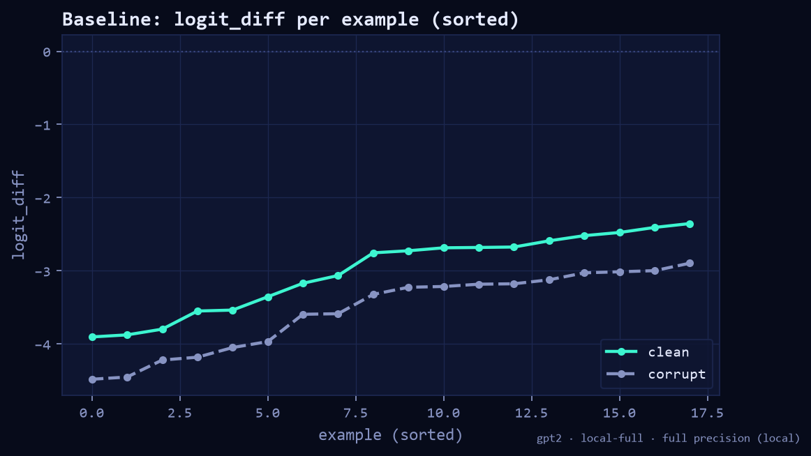
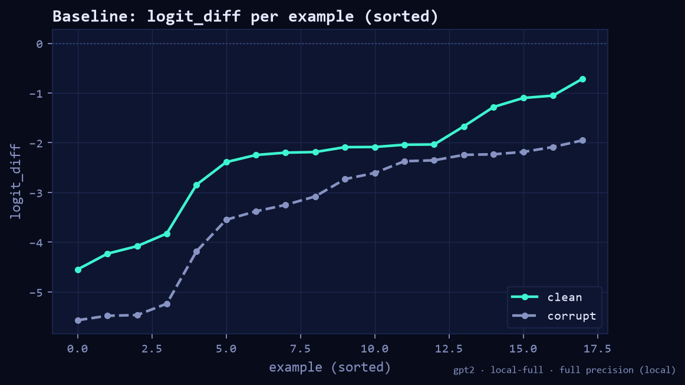

# GPT-2 small: ' a' vs ' an' before an unproduced noun - behaviour not present

**Behavior:** Claimed: GPT-2 small picks ' an' over ' a' when the upcoming (not yet produced) noun starts with a vowel, e.g. 'I climbed up the pear tree and picked a pear. I climbed up the apple tree and picked' -> ' an'. Metric: logit(' an') - logit(' a') on hand-written, position-aligned clean (vowel noun) / corrupt (consonant noun) pairs.  
**Model:** `gpt2` on `local-full`  
**Status:** unverified (no verification run) · negative result: behaviour absent, no mechanism claimed  
**Experiments run:** 2 · **Backends used:** full precision (local)  
**Written:** 2026-11-12 23:21

## Summary

On local-full gpt2 (full precision) the behaviour does not occur. Across 36 hand-written clean prompts in 7 prompt styles, ' a' beats ' an' every time (accuracy 0/36). The user's own example sentence scores -3.54 logits (predicts ' a'). There is a consistent sub-threshold sensitivity: swapping the consonant noun for a vowel noun raises the an-a logit diff in 36/36 pairs, by about +0.5 to +1.0 logits on average, but never enough to flip the choice. Following the protocol, the investigation stopped after the baseline stage. No mechanism experiments and no verification were run; nothing about the mechanism is claimed.

## The recovered algorithm

```python
def predict(tokens, prompt):
    # E0001, E0002: on every tested prompt the model prefers ' a' regardless of the cue noun.
    # This is a description of the measured output, not a recovered mechanism. Not run through verify_hypothesis.
    return ' a'
```

## Claims and evidence

| # | Claim | Evidence | Produced by |
|---|---|---|---|
| 1 | On the three original-style templates (tree / seller / box), including the user's example sentence, the clean an-a logit diff is -3.01 +/- 0.53 and ' an' wins in 0/18 prompts (local-full, full precision). | E0001 | full precision (local) |
| 2 | The failure is not template-specific: in four stronger styles (comma-separated parallel list, 'Want X: I want', few-shot with both articles in context, short declaratives) the clean logit diff is negative in 18/18 prompts (mean -2.37, best single prompt -0.71). | E0002 | full precision (local) |
| 3 | The model is weakly sensitive to the cue noun: clean exceeds corrupt in 36/36 pairs, mean shift +0.53 (E0001) and +0.96 (E0002) logits. Few-shot context with an 'an' example gets closest (clean mean -1.33 vs corrupt -2.40). | E0001, E0002 | full precision (local) |

## Key plots

**E0001: baseline** (full precision (local))



**E0002: baseline** (full precision (local))



## Limitations

- Only 36 hand-written pairs, mostly food nouns; a prompt family where gpt2 does choose ' an' may exist but was not found in 7 styles.
- No mechanism experiments were run, so the source of the +0.5 to +1.0 logit sensitivity is unmeasured.
- verify_hypothesis was not run; the pseudocode is a description of baseline outputs only.
- Token alignment of pairs was not reported explicitly by the baseline tool; no mismatch error was raised, but it was not independently confirmed.

## Open questions

- Which components produce the sub-threshold shift toward ' an' in gpt2? Patchable with the same pairs, using corrupt-to-clean logit-diff recovery as metric instead of accuracy.
- Does gpt2-medium (available on local-full) actually flip to ' an' on these prompts?

## Experiments

| id | primitive | backend / precision | seconds |
|---|---|---|---|
| E0001 | baseline | full precision (local) | 0.83 |
| E0002 | baseline | full precision (local) | 0.36 |

## Notebook trail

- `N0001` *decision*: Loaded gpt2 on local-full (full precision (local)).
- `N0002` *hypothesis* **[rejected]**: H1 (behaviour exists): On custom prompts of the form '... a pear. ... the {X} tree/seller/box ... picked/sold me/there was', GPT-2 small prefers ' an' over ' a' when X is a vowel-initial noun (apple, orange, egg, onion...) and ' a' when X is consonant-initial (lemon, peach...). Clean = vowel noun, corrupt = consonant noun in the same slot, same token count. Metric: logit(' an') - logit(' a'). Counts against: clean logit diff <= 0 or not clearly above corrupt logit diff; or token-length mismatch in pairs (then fix the pairs).
- `N0003` *experiment*: Tests H1: does the model do a/an at all on my hand-written pairs, and are pairs token-aligned? (E0001)
- `N0004` *result*: E0001 (local-full, full precision): on 18 hand-written pairs incl. the user's own example sentence, GPT-2 small does NOT output ' an'. Clean (vowel noun) logit diff an-a = -3.01 +/- 0.53, accuracy 0/18 (top prediction ' a' in every case). Corrupt (consonant noun) = -3.54. So there is only a weak shift of ~+0.53 logits toward ' an', never enough to flip the choice. The user's example 'I climbed up the pear tree ... apple tree and picked' gives -3.54 (predicts ' a'). H1 as stated is contradicted for these templates. (E0001)
- `N0005` *hypothesis* **[rejected]**: H2 (behaviour exists under stronger context): the failure in E0001 is template-specific; with prompts that constrain the next noun more strongly (comma-list parallel structure; 'X: I want' pattern; few-shot 'word: article word' lists that contain both a and an examples in clean AND corrupt so the article cannot be copied differentially) the clean logit diff becomes positive. Counts against: clean logit diff stays negative in all styles -> the model does not do the behaviour, stop and report. Mixed-style baseline: prompts 0-3 comma-list, 4-7 'X: I want', 8-13 few-shot with both articles, 14-17 'This is the X. It is'.
- `N0006` *experiment*: Tests H2: does any stronger prompt style produce a positive an-a logit diff? Index: 0-3 comma list, 4-7 'Want X: I want', 8-13 few-shot both articles, 14-17 short declaratives. (E0002)
- `N0007` *result*: E0002 (local-full, full precision): 18 new pairs in 4 stronger styles. Clean an-a logit diff is negative in all 18 (mean -2.37 +/- 1.13, accuracy 0/18); corrupt mean -3.33. By style (clean / corrupt means): comma-list -2.42 / -3.59; 'Want X: I want' -4.17 / -5.44; few-shot with both articles in context -1.33 / -2.40 (best single prompt -0.71); short declaratives -2.06 / -2.36. Across E0001+E0002 the vowel noun raises the diff in 36/36 pairs (mean shift +0.53 and +0.96) but never makes ' an' beat ' a'. (E0002)
- `N0008` *hypothesis* **[rejected]** -> N0002: Rejected by E0001: clean logit diff -3.01, accuracy 0/18, including the user's example sentence. Only a sub-threshold shift of +0.53 vs corrupt.
- `N0009` *hypothesis* **[rejected]** -> N0005: Rejected by E0002: clean logit diff negative in 18/18 prompts across four stronger styles (best -0.71), accuracy 0/18. The failure is not template-specific.
- `N0010` *decision*: Stop per step 1 of the protocol: gpt2 (small) on local-full does not perform the stated behaviour (0/36 clean prompts choose ' an' in E0001+E0002). No mechanism experiments run, no verify_hypothesis run, because there is no behaviour to explain. What exists is a consistent but sub-threshold sensitivity (vowel noun raises an-a by ~0.5-1.0 logits in 36/36 pairs); its mechanism is unmeasured. Options for the user: (a) investigate that weak shift in gpt2 as a 'partial sensitivity' study, (b) rerun on a larger model that actually flips to ' an'. 38 of 40 experiments unused.
