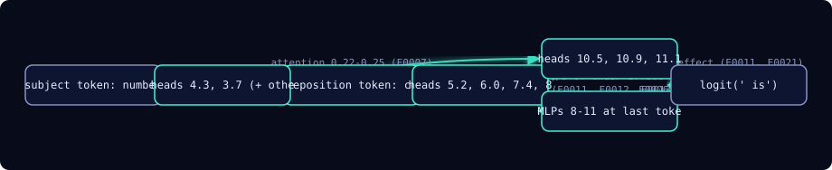
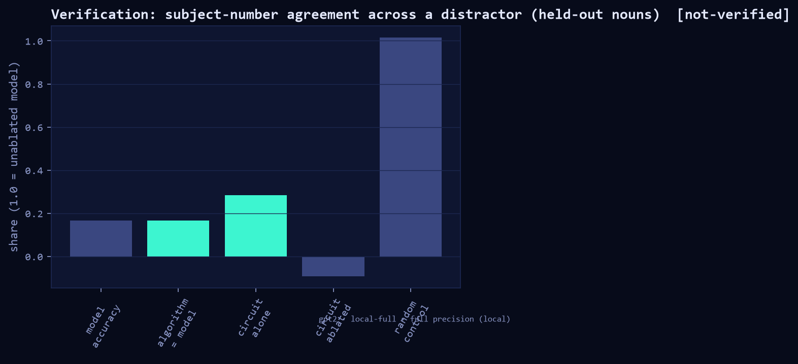
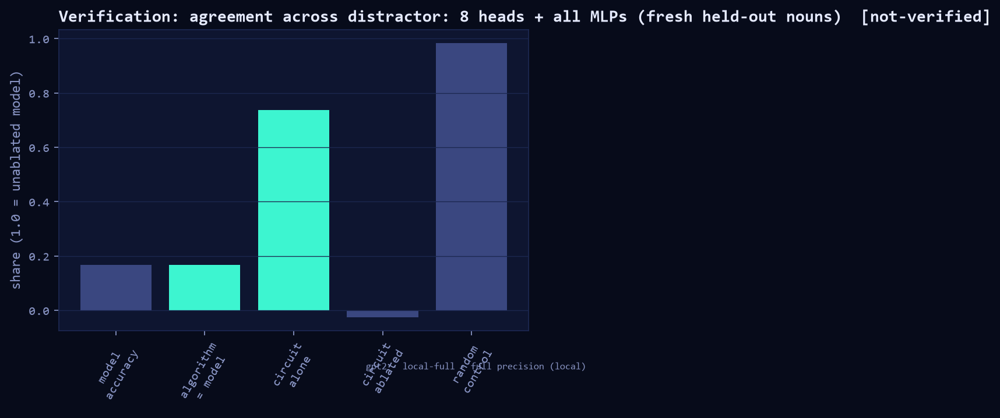
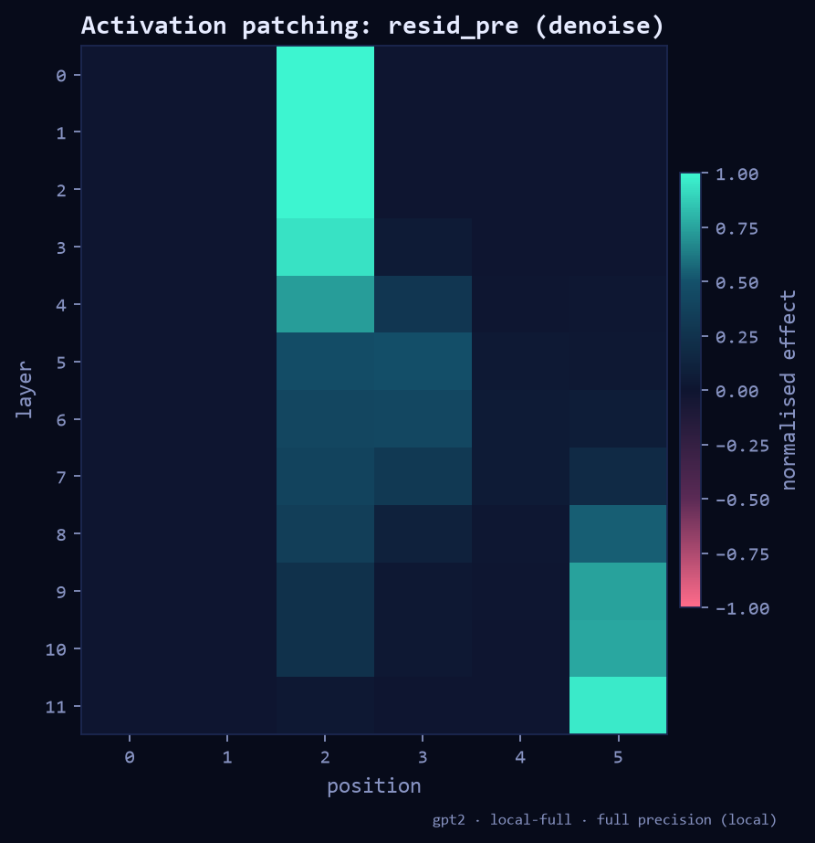
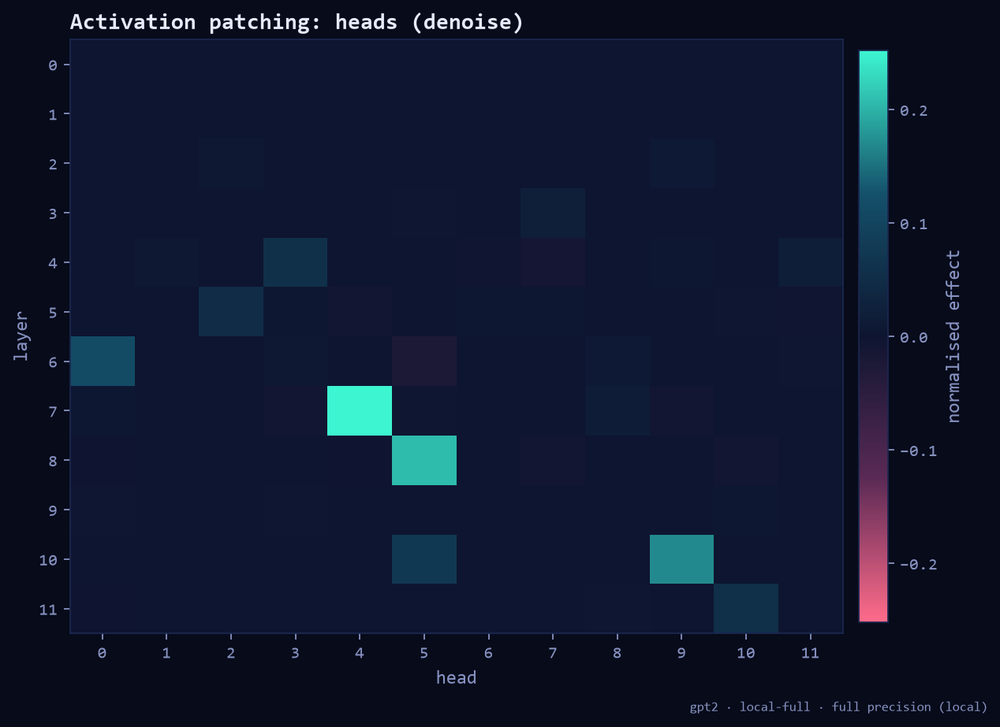
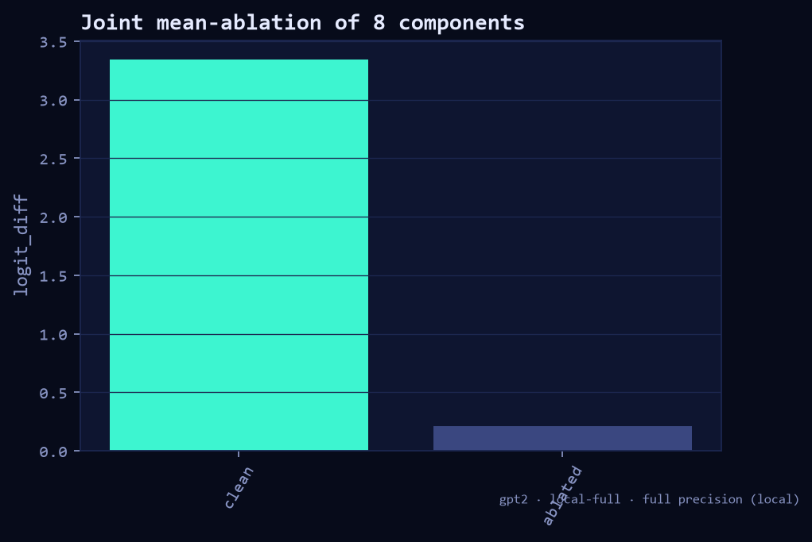
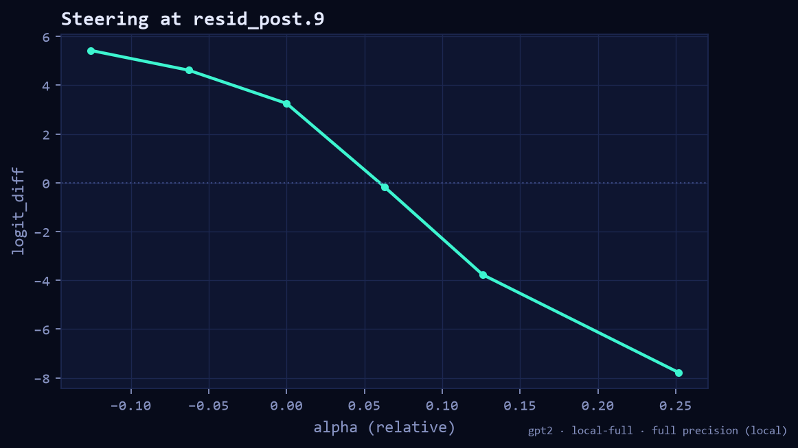

# GPT-2 small: subject-verb number agreement across a distractor noun

**Behavior:** On 'The {subject} {prep} the {distractor}' with a distractor of the opposite number, gpt2 (local-full, full precision) gives a higher logit to the verb form that agrees with the subject (' is' vs ' are'). Metric: logit(correct verb) - logit(incorrect verb) at the last token. Clean/corrupt pairs are hand-written, position-aligned (6 tokens incl. BOS); the corrupt prompt flips only the subject's number.  
**Model:** `gpt2` on `local-full`  
**Status:** partial / not verified · partial (causal checks pass on held-out prompts; top-1 agreement check fails)  
**Experiments run:** 27 · **Backends used:** full precision (local)  
**Written:** 2026-11-12 23:44

## Summary

All numbers are from the local-full backend (full precision). The model prefers the subject-agreeing verb form on 32/32 development prompts (mean logit diff +3.34) and on 96/96 held-out prompts, but is/are is the top-1 token on only ~17% of prompts: this is a preference between verb forms, not a top-1 prediction. Mechanism found: the subject's number sits at the subject token through layer 2; by layer 5 about half of the causal signal has also been written onto the preposition token; a small set of attention heads then moves it to the last token in two parallel groups: 5.2/6.0/7.4/8.5 (layers 5-8, attending mostly to the preposition) and 10.5/10.9/11.10 (layers 10-11, attending mostly to the subject noun). These heads write the verb preference partly directly (about 45% of the logit diff is direct head output) and the rest goes through MLPs, with MLPs 8-11 each mattering individually. Mean-ablating the 8 heads removes 94% of the effect; mean-ablating all other 136 heads leaves 74% on held-out prompts. MLPs 1-7 are individually dispensable but jointly needed. Two verification rounds: the first circuit (8 heads + 5 MLPs) was necessary but not sufficient (28%); the revised circuit (8 heads + all MLPs) passes both causal checks. The tool's top-1 agreement check fails in both rounds (0.167), so the status is partial, not verified.

## The recovered algorithm

```python
def predict(tokens, prompt):
    # 'The {subject} {prep} the {distractor}' -> preferred verb form (is vs are), NOT necessarily top-1 (E0001, V0001, E0027)
    # 1. number lives at the subject token, layers 0-2 (E0003)
    # 2. layers 2-5: ~half of it is also written onto the preposition; distributed, MLPs 1-7 jointly needed (E0003, E0010, E0022)
    # 3. heads 5.2/6.0/7.4/8.5 read mostly the preposition, heads 10.5/10.9/11.10 mostly the subject,
    #    and move number to the last token (E0004, E0007, E0008, E0015); the two groups are parallel (E0012)
    # 4. the heads (direct, E0011/E0021) and MLPs 8-11 (E0006/E0013) write the verb form; the distractor is ignored
    subject = prompt.strip().split()[1]
    return ' are' if subject.endswith('s') else ' is'
```

## Circuit



## Claims and evidence

| # | Claim | Evidence | Produced by |
|---|---|---|---|
| 1 | Behaviour exists as a preference: logit diff is positive on 32/32 development prompts (mean +3.34) and flips sign on 32/32 subject-flipped prompts (mean -4.36); on fresh held-out nouns it is 48/48 positive (mean +3.12) and 48/48 negative after flipping. is/are is top-1 on only 17-19% of prompts. | E0001, E0027, V0002 | full precision (local) |
| 2 | Position of the causal signal (exact resid patching, fraction of gap restored): subject token 1.00 in layers 0-2, falling to 0.46 by layer 5 and 0.03 at layer 11; preposition token rising to 0.49 at layer 5, gone by layer 9; determiner <= 0.06; last token 0.18 at layer 7, 0.55 at layer 8, 0.75 at layer 9, 0.97 at layer 11. The first-order attribution screen missed most of this and was not relied on. | E0003, E0002 | full precision (local) |
| 3 | Eight heads carry the attention side: exact single-head patching gives 7.4 0.25, 8.5 0.21, 10.9 0.17, 6.0 0.11, 10.5 0.08, 4.3 0.06, 11.10 0.055, 5.2 0.05, everything else < 0.025; single mean-ablations rank them identically. Jointly mean-ablating the eight leaves 6% of the logit diff, while eight control heads with strong attention to the subject leave 100%. | E0004, E0014, E0015, E0016 | full precision (local) |
| 4 | The other 136 heads are largely dispensable: the 66 non-circuit heads in layers 6-11 leave 103% when jointly mean-ablated, the 70 in layers 0-5 leave 84%, and on held-out prompts ablating all 136 at once leaves 73.7%. | E0024, E0023, V0002 | full precision (local) |
| 5 | From the last token, heads 5.2/6.0/7.4/8.5 attend more to the preposition (0.18-0.33) than to the subject (0.03-0.12); heads 10.5/10.9/11.10 attend more to the subject (0.22-0.25) than to the preposition (0.07-0.13). The late heads do not depend on the mid heads through their queries (path effect <= 0.001), so the two groups are parallel routes. | E0007, E0008, E0012 | full precision (local) |
| 6 | The heads write the verb preference partly directly: direct-path effects are 10.9 0.107, 7.4 0.079, 8.5 0.064 (of total effects 0.171, 0.252, 0.208); direct logit attribution of all heads sums to 1.52 of 3.34 logits, the rest is written by non-head components. | E0011, E0021, E0004 | full precision (local) |
| 7 | MLPs: MLP 8-11 matter individually (exact patching 0.13, 0.22, 0.33, 0.24; mean-ablation leaves 63%, 88%, 64%, 71%). MLPs 1-7 are individually dispensable and so is each block (MLP 1-3: 107%, MLP 4-7: 92%), but ablating all seven leaves 59%: a redundant group. | E0006, E0013, E0022, E0025, E0026 | full precision (local) |
| 8 | The relay onto the preposition is distributed: many layer 2-4 heads attend from the preposition to the subject (4.11 1.00, 2.9 0.80, 2.2 0.71, 3.7 0.70, 4.3 0.67), but their path into the values of 6.0/7.4/8.5 carries only ~0.1 in total (4.3 0.039, 3.7 0.025), far less than the 0.49 present at the preposition. | E0009, E0010, E0003 | full precision (local) |
| 9 | A 'plural subject' direction at the last token is causally sufficient: adding one natural unit of the plural-minus-singular mean difference at resid_post.9 moves the is-minus-are logit diff on singular-subject prompts from +3.26 to -3.77, monotonically in the dose. A linear probe at the last token decodes subject number at 0.85 by layer 7-9 and 1.00 from layer 10, but with only 20 test prompts this is weak support. | E0020, E0018, E0017 | full precision (local) |
| 10 | Verification round 1 (8 heads + MLP 0, 8-11) failed sufficiency: circuit ablated -9%, everything else ablated 28% (threshold 70%), random controls 96-106%. Round 2 (8 heads + all MLPs, fresh nouns) passes the causal checks: circuit alone 73.7%, circuit ablated -2.5%, random controls 96-100%. Both rounds fail the top-1 agreement check (0.167), so the tool status is not-verified. | V0001, V0002 | full precision (local) |

## Verification

### V0001: subject-number agreement across a distractor (held-out nouns)  (full precision (local))

| check | value |
|---|---|
| status | not-verified |
| held-out inputs | 48 |
| model accuracy | 0.167 |
| algorithm agrees with model | 0.167 |
| algorithm accuracy vs ground truth | 1.000 |
| circuit size | 13 of 156 components |
| metric kept with ONLY the circuit | 0.283 |
| metric kept with the circuit ABLATED | -0.092 |
| random same-size ablation (control) | 0.957, 1.057, 1.030 |

At least one check failed; the explanation is partial or wrong. See the numbers.



### V0002: agreement across distractor: 8 heads + all MLPs (fresh held-out nouns)  (full precision (local))

| check | value |
|---|---|
| status | not-verified |
| held-out inputs | 48 |
| model accuracy | 0.167 |
| algorithm agrees with model | 0.167 |
| algorithm accuracy vs ground truth | 1.000 |
| circuit size | 20 of 156 components |
| metric kept with ONLY the circuit | 0.737 |
| metric kept with the circuit ABLATED | -0.025 |
| random same-size ablation (control) | 0.985, 1.001, 0.964 |

At least one check failed; the explanation is partial or wrong. See the numbers.



## Key plots

**E0003: activation_patching** (full precision (local))



**E0004: activation_patching** (full precision (local))



**E0015: ablation** (full precision (local))



**E0020: steering** (full precision (local))



## Limitations

- Status is partial: the tool's agreement check compares predict() with the model's top-1 token and scores 0.167 in V0001 and V0002, because is/are is rarely top-1. Preference-level agreement is 96/96 on held-out prompts (E0027), but that is my own reading of a baseline, not the tool's verification check.
- The verified circuit keeps all 12 MLPs. The sparsity claim is about attention only (8 of 144 heads). 'Circuit ablated' in V0002 removes every MLP and would break nearly any behaviour; the informative necessity results are E0015 and V0001.
- Circuit-alone performance is 73.7%, just above the 70% threshold; a quarter of the effect lives in the 136 other heads (mostly layers 0-5, E0023).
- The link 'mid heads -> late MLPs' is inferred, not measured: path patching with MLP receivers is not supported by the tool (the attempt raised KeyError and produced no experiment).
- One prompt template only: 'The N prep the N', one-token regular nouns with plural in -s, verbs is/are, a single distractor adjacent to the verb position. Longer distractor phrases, irregular plurals, other verbs and relative clauses were not tested.
- Layer-level attn_out/mlp_out patching was not split by position (E0005, E0006), and the steering output does not confirm that E0020 was restricted to the last position. E0019 used an 8x overdose and is not evidence for natural-scale behaviour.
- Single-component denoising effects are not additive here (E0005 vs E0003), so the fractions should not be summed.
- The probe (E0017) has 20 test prompts and a noisy control; the diff-of-means direction separates held-out prompts poorly before layer 10 (E0018).

## Open questions

- Which components write the subject's number onto the preposition? The early prep->subject heads explain ~0.1 of 0.49, and MLPs 1-7 matter only as a group.
- Do MLPs 8-11 read the output of heads 6.0/7.4/8.5 at the last token, as the indirect-effect numbers suggest?
- Why are MLP 1-3 and MLP 4-7 mutually redundant (107% and 92% alone, 59% together)?
- Does the same head set handle longer attractor phrases, several distractors, or other verbs (was/were, has/have)?
- What is in the 26% that is lost when the 136 non-circuit heads are ablated?

## Experiments

| id | primitive | backend / precision | seconds |
|---|---|---|---|
| E0001 | baseline | full precision (local) | 0.52 |
| E0002 | attribution_patching | full precision (local) | 0.62 |
| E0003 | activation_patching | full precision (local) | 1.36 |
| E0004 | activation_patching | full precision (local) | 2.58 |
| E0005 | activation_patching | full precision (local) | 0.51 |
| E0006 | activation_patching | full precision (local) | 0.54 |
| E0007 | attention_patterns | full precision (local) | 0.25 |
| E0008 | attention_patterns | full precision (local) | 0.23 |
| E0009 | attention_patterns | full precision (local) | 0.21 |
| E0010 | path_patching | full precision (local) | 0.49 |
| E0011 | path_patching | full precision (local) | 0.42 |
| E0012 | path_patching | full precision (local) | 0.36 |
| E0013 | ablation | full precision (local) | 0.34 |
| E0014 | ablation | full precision (local) | 3.1 |
| E0015 | ablation | full precision (local) | 0.14 |
| E0016 | ablation | full precision (local) | 0.14 |
| E0017 | linear_probe | full precision (local) | 0.45 |
| E0018 | diff_of_means | full precision (local) | 0.23 |
| E0019 | steering | full precision (local) | 0.52 |
| E0020 | steering | full precision (local) | 0.34 |
| E0021 | direct_logit_attribution | full precision (local) | 0.23 |
| E0022 | ablation | full precision (local) | 0.29 |
| E0023 | ablation | full precision (local) | 0.13 |
| E0024 | ablation | full precision (local) | 0.16 |
| E0025 | ablation | full precision (local) | 0.28 |
| E0026 | ablation | full precision (local) | 0.29 |
| E0027 | baseline | full precision (local) | 0.16 |
| V0001 | verify | full precision (local) |  |
| V0002 | verify | full precision (local) |  |

## Notebook trail

- `N0001` *decision*: Loaded gpt2 on local-full (full precision (local)).
- `N0002` *hypothesis* **[supported]**: H1 (behaviour): On prompts 'The {subject} {prep} the {distractor}' where the distractor noun has the OPPOSITE number to the subject, gpt2 gives a higher logit to the verb form agreeing with the subject (' is' vs ' are'). Dataset: 16 noun items x 2 (sg subject + pl distractor; pl subject + sg distractor) = 32 clean prompts; corrupt = same prompt with subject number flipped (distractor unchanged, same token count). Metric: logit_diff(correct verb - incorrect verb) at final position. Against H1: mean logit diff <= 0 or accuracy near 50%, or clean/corrupt token lengths misaligned.
- `N0003` *experiment*: Baseline for H1: subject-verb agreement across an opposite-number distractor (E0001)
- `N0004` *result*: E0001 (local-full): logit diff (correct - incorrect verb) is positive on 32/32 clean prompts (mean +3.34, min +1.46) and negative on 32/32 corrupt prompts scored with clean labels (mean -4.36). So the model prefers the subject-agreeing verb form over the distractor-agreeing one in every pair. Note: top-1 'accuracy' is only 0.19 because the argmax token is often something other than is/are (e.g. ' "', ','); the behaviour is a relative preference between verb forms, not top-1 prediction. Clean and corrupt aligned (no length error). (E0001)
- `N0005` *hypothesis* **[supported]** -> N0002: Supported by E0001: 32/32 clean prompts have positive logit diff; with the caveat that is/are is often not the top-1 token.
- `N0006` *hypothesis* **[revised]**: H2 (where): The subject's number is read at the subject token (pos 2) in early layers and must be moved to the final position (the distractor noun, pos 5) by attention heads in middle layers, since only the subject token differs between clean and corrupt. Prediction for attribution patching (corrupt->clean): effect concentrated at the subject position in early layers and at the final position in later layers, with a small number of heads carrying the transfer. Against H2: effect spread diffusely over all positions/heads, or large effects at positions other than subject and final (e.g. preposition / 'the') would mean number is relayed through intermediate tokens.
- `N0007` *experiment*: Screen for H2: where (layer/position/head) does subject number matter? (E0002)
- `N0008` *result*: E0002 attribution screen (local-full, first-order estimate only, normalised effect; positions: 0=BOS,1=The,2=subject,3=prep,4=the,5=distractor/final). Top heads: 7.4 (0.16), 8.5 (0.145), 10.9 (0.13), 6.0 (0.07), 10.5 (0.07), 11.10 (0.05), 5.2 (0.03). Resid: final pos dominates from layer 8 on; subject pos 2 moderate; the PREPOSITION pos 3 has estimated effect in layers 5-7 (0.11-0.19), which H2 did not predict. MLPs 8-11 at the final position have large estimates (0.07-0.29). Caveat: the estimate is badly non-conservative (resid_pre.0 @ subject is -0.008 although it must be ~1.0 exactly), so nothing here is trusted until activation patching confirms. (E0002)
- `N0009` *experiment*: Exact test of H2: resid_pre by layer x position. Against H2: substantial effect at pos 3/4 (relay through intermediate tokens). (E0003)
- `N0010` *result*: E0003 exact resid_pre patching (local-full, corrupt->clean denoise, effect = fraction of clean-corrupt gap restored). Subject pos 2: 1.00 (L0-2), 0.94 (L3), 0.73 (L4), 0.46 (L5), 0.42 (L6), 0.39 (L7), 0.35 (L8), 0.24 (L9-10), 0.03 (L11). Preposition pos 3: 0.06 (L3), 0.28 (L4), 0.49 (L5), 0.43 (L6), 0.31 (L7), 0.10 (L8), 0.03 (L9). 'the' pos 4: <=0.06 everywhere. Final pos 5: 0.03 (L5), 0.07 (L6), 0.18 (L7), 0.55 (L8), 0.75 (L9), 0.76 (L10), 0.97 (L11). Reading: (a) layers 3-4 copy about half of the subject-number signal onto the preposition token; (b) layers 7-8 move it to the final position (from prep and/or subject); (c) layer 10 moves a remaining ~0.2 from the subject token to the final position. The determiner 'the' carries almost nothing. (E0003)
- `N0011` *hypothesis* **[revised]** -> N0006: Revised by E0003: number is not only moved subject->final. About half of the signal is first relayed onto the preposition token (pos 3) in layers 3-4, then read from there in layers 7-8; the direct subject->final part is carried mostly in layers 7-8 and again at layer 10. The 'against' condition (large effect at the preposition) occurred, so the single-hop version of H2 is wrong.
- `N0012` *hypothesis* **[supported]**: H3 (which heads): the movement to the final position is carried by a few heads flagged by the screen: 7.4, 8.5 (layers 7-8 step) and 10.9, 10.5 (layer 10 step), plus smaller 6.0, 11.10. Exact head-output patching (corrupt->clean) should give each of these a clearly larger effect than every other head. Against H3: exact effects of these heads near zero, or other heads (not in the screen) dominating. The early prep-relay heads (layers 3-4) are not identified by the screen, so the head sweep should also reveal which layer 3-4 heads have effect.
- `N0013` *experiment*: Exact test of H3: per-head output patching corrupt->clean (E0004)
- `N0014` *result*: E0004 exact head-output patching (local-full, corrupt->clean, fraction restored): 7.4 0.252, 8.5 0.208, 10.9 0.171, 6.0 0.114, 10.5 0.077, 4.3 0.057, 11.10 0.055, 5.2 0.050, 3.7 0.022, 4.11 0.018; largest negative 6.5 -0.025; all other heads |effect| < 0.02. The six heads named in H3 are indeed the top ones, in the same order as the screen; new: 4.3 and 5.2 (not predicted). No single layer 3-4 head explains the 0.49 that arrives at the preposition by layer 5, so that relay is either distributed over heads or involves MLPs: open. (E0004)
- `N0015` *hypothesis* **[supported]** -> N0012: Supported by E0004 for the named heads (7.4, 8.5, 10.9, 6.0, 10.5, 11.10 are the top exact effects, with 4.3 and 5.2 added). Not yet shown: where each head attends and which position it writes to.
- `N0016` *hypothesis* **[open]**: H4 (layer-level bookkeeping): (a) attention layers 3-4 write the number signal at the preposition position (pos 3); (b) attention layers 6-8 and 10 write it at the final position (pos 5); (c) MLPs at the final position in layers 8-11 matter as flagged by the screen (they would turn 'subject is plural' into verb-form logits). Test: exact attn_out and mlp_out patching by layer x position. Against: (a) fails if attn_out L3-4 @ pos 3 effects are ~0 (then MLP or something else does the relay); (c) fails if mlp_out @ pos 5 exact effects are < 0.05 everywhere.
- `N0017` *experiment*: H4 a,b: attn_out by layer x position (E0005)
- `N0018` *experiment*: H4 c: mlp_out by layer x position (E0006)
- `N0019` *result*: E0005/E0006 exact layer-level patching (local-full, all positions at once; the tool did not split by position, so the positional part of H4 is untested here). attn_out: L10 0.285, L7 0.277, L8 0.173, L6 0.099, L5 0.061, L11 0.054, L4 0.043, L3 0.041, L2 0.027, L9 0.013. mlp_out: L0 0.988 (the subject token's identity/number passes through MLP0), L10 0.332, L11 0.243, L9 0.220, L8 0.127, L1-7 each <= 0.035. So late MLPs 8-11 matter (H4c holds at layer level), and attention layers 3-4 have only ~0.04 each although the preposition residual carries 0.49 by layer 5 (E0003): single-layer denoising effects are not additive here, the prep relay is spread over layers 2-5. (E0005, E0006)
- `N0020` *hypothesis* **[supported]**: H5 (what the mover heads read): at the final position, heads 7.4, 8.5, 6.0 attend to the subject noun (pos 2) and/or the preposition (pos 3), and 10.9, 10.5, 11.10 attend to the subject noun (pos 2), since E0003 shows the subject residual still matters until layer 10 while the prep residual stops mattering after layer 8. Test: attention from query pos 5 to key pos 2 and to key pos 3 for all heads. Against: these heads put < 0.1 attention on pos 2 and pos 3 (then they are not moving number from those tokens; they would be transforming information already at the final position).
- `N0021` *experiment*: H5: attention final(5) -> subject(2), all heads (E0007)
- `N0022` *experiment*: H5: attention final(5) -> preposition(3), all heads (E0008)
- `N0023` *experiment*: Prep relay: attention preposition(3) -> subject(2), all heads (which early heads copy number onto the preposition?) (E0009)
- `N0024` *result*: Attention patterns (local-full, mean over 32 clean prompts). From the FINAL position (5): 6.0 -> subj 0.045 / prep 0.332; 7.4 -> subj 0.067 / prep 0.209; 8.5 -> subj 0.119 / prep 0.180; 5.2 -> subj 0.025 / prep 0.193; 10.9 -> subj 0.220 / prep 0.128; 10.5 -> subj 0.243 / prep 0.075; 11.10 -> subj 0.245 / prep 0.074 (E0007, E0008). So the layer 5-8 heads look mostly at the preposition, the layer 10-11 heads mostly at the subject noun; all put most of their remaining weight on BOS, so these are modest attention weights (0.2-0.33), not sharp pointers. From the PREPOSITION (3) to the subject (2): 4.11 1.00, 2.9 0.80, 2.2 0.71, 3.7 0.70, 4.3 0.67, 4.1 0.47, 2.4 0.47, 3.3 0.45 (E0009): many early heads look from the preposition back at the subject, consistent with a distributed relay. Attention alone is correlational; path patching needed. (E0007, E0008, E0009)
- `N0025` *hypothesis* **[supported]** -> N0020: Supported with a refinement (E0007, E0008): none of the mover heads falls below the 0.1 threshold on both positions. Layer 5-8 heads (6.0, 7.4, 8.5, 5.2) prefer the preposition; layer 10-11 heads (10.9, 10.5, 11.10) prefer the subject. Weights are moderate (0.18-0.33).
- `N0026` *hypothesis* **[revised]**: H6 (two-hop path): early heads that attend prep->subject (2.2, 2.9, 3.7, 4.3, 4.11) write subject number onto the preposition, and the mid heads 6.0, 7.4, 8.5 read it there through their VALUE input. Test: path patching senders [2.2, 2.9, 3.7, 4.3, 4.11] -> receivers [6.0, 7.4, 8.5] input v. Prediction: effect clearly > 0 (order 0.1, given the non-additivity seen in E0005). Against: effect < 0.02, meaning the mid heads get number via another route (MLPs at the prep, or directly from the subject token).
- `N0027` *experiment*: H6: early prep->subject heads -> value input of 6.0/7.4/8.5 (E0010)
- `N0028` *experiment*: Direct path of mover heads to logits (vs. total effect in E0004): which heads write the verb form directly and which act through later components? (E0011)
- `N0029` *result*: Path patching (local-full, per sender, fraction restored). E0010 early heads -> VALUE input of {6.0, 7.4, 8.5}: 4.3 0.039, 3.7 0.025, 4.11 0.014, 2.9 0.012, 2.2 0.007 (sum 0.097). Compared with their total effects in E0004 (4.3 0.057, 3.7 0.022, 4.11 0.018, 2.9 0.011, 2.2 0.008), most of what these early heads do is mediated by the values of 6.0/7.4/8.5. But the amounts are small: the five heads together account for ~0.1, far less than the 0.49 the preposition residual carries (E0003). E0011 direct path to logits vs total effect (E0004): 10.9 0.107 of 0.171; 7.4 0.079 of 0.252; 8.5 0.064 of 0.208; 11.10 0.046 of 0.055; 10.5 0.046 of 0.077; 6.0 0.046 of 0.114; 5.2 0.029 of 0.050; 4.3 0.007 of 0.057. So the layer 10-11 heads write the verb preference mostly directly, whereas 6.0/7.4/8.5 act about two thirds INDIRECTLY, through later components (late MLPs and/or late heads). (E0010, E0011, E0004)
- `N0030` *hypothesis* **[revised]** -> N0026: Revised by E0010: the path early prep-heads -> value of 6.0/7.4/8.5 exists and carries most of those early heads' effect (4.3 and 3.7 pass the 0.02 bar; 4.11, 2.9, 2.2 do not), but it explains only ~0.1 of the gap. The relay onto the preposition is distributed; no small set of early heads carries it. I will not claim specific early relay heads as necessary circuit members beyond 4.3 and 3.7 as the largest contributors.
- `N0031` *hypothesis* **[open]**: H7 (indirect route of mid heads): the indirect two thirds of 6.0/7.4/8.5 goes through late MLPs at the final position (MLP 8-11 had exact effects 0.13-0.33 in E0006) rather than through the late heads' queries. Test 1: path patching senders [6.0, 7.4, 8.5] -> receivers [10.5, 10.9, 11.10] input q. If H7 is right this is small (< 0.03 per sender); if instead it is > 0.05 per sender, the late heads depend on the mid heads (a head->head chain) and H7 is wrong in that part. Test 2 (next): mean-ablating MLPs 8-11 should remove a large part of the logit diff.
- `N0032` *experiment*: H7 test 1: mid heads -> query of late heads (E0012)
- `N0033` *experiment*: H7 test 2: mean-ablation sweep over MLPs (E0013)
- `N0034` *experiment*: Necessity screen: mean-ablation sweep over all heads (do the heads found by denoising also matter when knocked out? any head denoising missed?) (E0014)
- `N0035` *result*: E0012 (local-full) path patching mid heads -> QUERY of {10.5, 10.9, 11.10}: 6.0 0.001, 7.4 -0.001, 8.5 0.000, 5.2 0.000. The late heads do not depend on the mid heads through their queries: the two groups act in parallel, not as a chain. E0013 mean-ablation sweep of MLPs (reference = clean-set mean; clean metric 3.34): mlp0 -> 1.87, mlp8 -> 2.11, mlp10 -> 2.14, mlp11 -> 2.38, mlp9 -> 2.96; mlp1-7 change by <= +0.18 (slightly up). E0014 mean-ablation sweep of heads: 7.4 -> 2.67 (-0.67), 10.9 -> 2.78 (-0.56), 8.5 -> 2.85 (-0.49), 6.0 -> 3.10 (-0.24), 10.5 -> 3.11 (-0.23), 11.10 -> 3.16 (-0.18), 5.2 -> 3.23 (-0.11), 4.3 -> 3.25 (-0.09), 7.8 -> 3.27 (-0.07); every other head |change| < 0.06. Knock-out ranking matches the denoising ranking (E0004), no hidden head. No single component is necessary on its own: the largest single knock-outs remove 20% (head 7.4) and 37-44% (mlp8, mlp10, mlp0). (E0012, E0013, E0014)
- `N0036` *hypothesis* **[supported]**: H8 (joint necessity and the MLP link): (a) Jointly mean-ablating the 8 heads {4.3, 5.2, 6.0, 7.4, 8.5, 10.5, 10.9, 11.10} removes most of the logit diff (prediction: metric falls below 1.0 from 3.34, i.e. > 70% lost). Against: metric stays > 2.0 (then other heads compensate or carry the signal and the head set is incomplete). (b) the indirect effect of 6.0/7.4/8.5 flows into MLPs 8-11: path patching senders [6.0, 7.4, 8.5] with MLPs as receiver, if the tool supports an MLP receiver; otherwise this stays an inference from E0011 + E0012 + E0013 and is reported as such.
- `N0037` *experiment*: H8a: joint mean ablation of the 8 candidate heads (E0015)
- `N0038` *experiment*: Control for H8a: joint mean ablation of 8 heads I claim do NOT matter (incl. 11.8 and 1.10 which attend strongly final->subject, and 2.2/3.3 which attend prep->subject). Prediction: metric stays > 3.0. (E0016)
- `N0039` *result*: E0015 (local-full): joint mean ablation of the 8 heads {4.3, 5.2, 6.0, 7.4, 8.5, 10.5, 10.9, 11.10} drops the logit diff from 3.34 to 0.21 (6% of clean). E0016 control: joint mean ablation of 8 other heads {7.8, 6.5, 2.2, 8.7, 9.3, 3.3, 1.10, 11.8}, chosen to include heads with strong final->subject or prep->subject attention (11.8 0.40, 1.10 0.22, 2.2 0.71, 3.3 0.45), leaves it at 3.35 (100%). So attention to the subject is not sufficient to matter; the 8 named heads are jointly necessary on this dataset. An attempted path patch with MLPs as receiver failed (KeyError 'heads': the tool only accepts head receivers; no experiment id was issued), so the 'mid heads -> late MLPs' link cannot be measured directly here. (E0015, E0016)
- `N0040` *hypothesis* **[supported]** -> N0036: (a) supported by E0015 (0.21 < 1.0) with control E0016 (3.35). (b) NOT tested: MLP receivers unsupported in path_patching. It remains an inference: mid heads are 2/3 indirect (E0011), not via late-head queries (E0012), and MLPs 8-11 each matter when ablated (E0013).
- `N0041` *hypothesis* **[revised]**: H9 (what is represented where): the subject's number becomes linearly decodable at the FINAL position only once the mover heads have written it, i.e. probe accuracy at the last token for 'subject is plural' is near chance in layers 0-5 and rises to > 0.9 by layers 8-9 (matching E0003 where the final-position residual effect goes 0.07 -> 0.55 -> 0.75 over layers 6-9). Data: the 64 prompts (clean + corrupt), in which subject number and distractor number are crossed (all 4 combinations equally often), so the probe cannot use the distractor's own number. Against: accuracy already high in layers 0-4 (then the info is at the final position before the movers act, contradicting the patching picture), or never above the control.
- `N0042` *experiment*: H9: probe 'subject is plural' at the final token, per layer; distractor number crossed (E0017)
- `N0043` *result*: E0017 (local-full) linear probe for 'subject is plural' at the final token (64 prompts, 44 train / 20 test, subject and distractor number crossed). Held-out accuracy by resid_post layer 0..11: 0.15, 0.15, 0.40, 0.60, 0.70, 0.70, 0.80, 0.85, 0.85, 0.85, 1.00, 1.00. Shuffled-label control ranges 0.25-0.65. With only 20 test prompts each step is 0.05 and the control itself swings by +-0.2, so this is weak evidence: the trend (not decodable in layers 0-2, perfectly decodable from layer 10) agrees with the patching picture, but the specific prediction '> 0.9 by layer 8-9' was not met (0.85), and the below-chance 0.15 in layers 0-1 shows the small-sample probe is unreliable there. (E0017)
- `N0044` *hypothesis* **[revised]** -> N0041: Revised by E0017: direction of the prediction holds (chance or below early, 1.0 at layers 10-11) but the threshold was missed at layers 8-9 (0.85) and the probe is underpowered (n_test = 20). Treated as weak corroboration only; no claim rests on it alone.
- `N0045` *hypothesis* **[supported]**: H10 (a number direction is causally sufficient at the final position): the difference of mean residuals (plural-subject prompts minus singular-subject prompts, distractor number balanced) at the final position in layers ~8-10 is a 'subject is plural' direction. Adding it at the final position on singular-subject prompts should push the logit diff (' is' - ' are') from positive to negative, and subtracting it should increase it, monotonically in alpha. Against: no monotone change, or the sign never flips at alphas of the order of the natural difference (alpha ~ 1-2 in units of the mean difference).
- `N0046` *experiment*: H10 step 1: plural-subject minus singular-subject direction per layer (distractor balanced) (E0018)
- `N0047` *experiment*: H10 step 2: add the plural-subject direction at resid_post.9 on singular-subject prompts; metric = logit(is) - logit(are) (E0019)
- `N0048` *experiment*: H10 rerun at natural scale: E0019 used relative scale where alpha=1 is the full residual norm (154), ~8x the natural plural-singular difference (norm 19.75 = 0.126 relative at resid_post.9). alpha=0.126 is one natural unit. (E0020)
- `N0049` *result*: E0018 (local-full) diff-of-means direction 'plural subject minus singular subject' at the final token (32 vs 32, distractor balanced): norm grows 0.9 (L0) -> 7.7 (L6) -> 15.6 (L8) -> 19.8 (L9) -> 37.4 (L10) -> 55.6 (L11); as a held-out classifier the raw mean-difference is poor until late (accuracy 0.34-0.47 through L9, 0.66 at L10, 0.84 at L11), so it is not a clean read-out direction. Steering is the causal test. E0019 used the tool's relative scale (alpha 1 = full residual norm 154.7, about 8x the natural difference) and is therefore an overdose: metric (is - are on 16 singular-subject prompts) 3.26 -> -19.1 at alpha 1. E0020 at natural scale (alpha 0.126 = one plural-minus-singular unit at resid_post.9): alpha -0.126: 5.43; -0.063: 4.62; 0: 3.26; +0.063: -0.17; +0.126: -3.77; +0.252: -7.78. Monotone, and one natural unit flips the preference to about the value plural-subject prompts have (corrupt mean -4.36 in E0001). Caveat: I passed pos=-1 but the output does not confirm whether steering was restricted to the final position. (E0018, E0019, E0020)
- `N0050` *hypothesis* **[supported]** -> N0045: Supported by E0020 (monotone, sign flips at one natural unit). E0019 not used as evidence for natural-scale behaviour (8x overdose). Position restriction unconfirmed.
- `N0051` *hypothesis* **[supported]**: H11 (who writes the answer): the direct write along the (correct - incorrect verb) unembedding direction comes mainly from heads 10.9, 7.4, 8.5 (largest direct path effects in E0011) and no head outside the 8-head set has a comparable direct contribution. Test: direct_logit_attribution on the clean prompts. Against: a head outside the set with a direct contribution as large as 10.9's, or the named heads having ~0 direct attribution.
- `N0052` *experiment*: H11: direct logit attribution per head/MLP along correct-minus-incorrect verb direction (E0021)
- `N0053` *result*: E0021 (local-full) direct logit attribution along (correct - incorrect verb), clean prompts, logit units: 10.9 +0.434, 7.4 +0.314, 8.5 +0.230, 10.5 +0.176, 6.0 +0.169, 11.10 +0.169, 5.2 +0.106; largest outside the set: 0.5 -0.054, 6.5 -0.047, 7.8 +0.031. All heads together contribute 1.52 of the 3.34 logit diff, the seven named heads 1.60 (other heads net slightly negative). The remaining ~1.8 (about 55%) is written directly by non-head components (MLPs / embeddings), consistent with late MLPs 8-11 mattering in E0006/E0013. H11 holds: no outside head has a comparable direct write. (E0021)
- `N0054` *hypothesis* **[supported]** -> N0051: Supported by E0021.
- `N0055` *hypothesis* **[revised]**: H12 (the algorithm, to be verified on held-out nouns): predict(prompt) = ' are' if the subject noun (token 2) is plural else ' is', ignoring the distractor. Circuit = heads {4.3, 5.2, 6.0, 7.4, 8.5, 10.5, 10.9, 11.10} + MLPs {0, 8, 9, 10, 11}. Held-out set: 24 NEW subject nouns, new distractor nouns and partly new prepositions (in, at, for, on, over), 48 clean/corrupt pairs, none used in E0001-E0021. Predictions: (1) the model's preferred verb form matches predict() on > 90% of prompts; (2) mean-ablating the circuit removes most of the logit diff; (3) mean-ablating everything outside the circuit keeps most of it; (4) a random same-size set does much less than the circuit. Against: any of these failing; (3) is the riskiest, since E0003/E0010 showed the early relay onto the preposition is distributed over components I did NOT put in the circuit.
- `N0056` *verification*: subject-number agreement across a distractor (held-out nouns): not-verified. At least one check failed; the explanation is partial or wrong. See the numbers. (V0001)
- `N0057` *result*: V0001 (local-full, 48 held-out pairs, new subject nouns): NOT verified. (1) Behaviour generalises: clean logit diff 3.23 on held-out nouns (3.34 on the development set). (2) Agreement check FAILED: 0.167. The tool compares predict() with the model's top-1 token, and the model's top-1 after these prompts is usually ',', ' "', ' were' etc.; is/are is top-1 on only 17% of prompts. predict() matches the grammatical ground truth on 100%, but the tool does not report how often the model's is-vs-are preference matches it, so the algorithm describes a relative preference between two verb forms, not the model's next-token output. (3) Circuit ablated (8 heads + MLP 0, 8-11, mean, corrupt reference): logit diff -0.30 (-9% of clean) -> necessity PASSES; 3 random same-size sets leave 96-106%. (4) Everything else ablated: 0.92 (28% of clean), threshold 0.7 -> sufficiency FAILS. As anticipated in H12, the 13 components are necessary but not sufficient: something outside them (candidates: the distributed early prep-relay heads, MLPs 1-7) carries or prepares the signal. (V0001)
- `N0058` *hypothesis* **[revised]** -> N0055: Revised by V0001: predictions (2) and (4) held, (1) failed as measured (top-1 agreement 0.17; the behaviour is a preference between verb forms, not top-1), (3) failed (28% survives on the circuit alone). The 13-component circuit is necessary, not sufficient.
- `N0059` *hypothesis* **[revised]**: H13 (what is missing): the sufficiency gap comes from (A) non-circuit attention heads, mainly the early layer 2-5 heads that relay number onto the preposition, and/or (B) MLPs 1-7. Tests on the development set, joint mean ablation: (A) all 136 non-circuit heads with all MLPs intact; (B) MLPs 1-7 with all heads intact. Whichever group drops the logit diff well below the clean 3.34 holds the missing part. Against H13-A: (A) leaves > 80%; against H13-B: (B) leaves > 80%. If both leave > 80% the gap is an interaction that only appears when both are removed.
- `N0060` *experiment*: H13-B: joint mean ablation of MLPs 1-7 (E0022)
- `N0061` *experiment*: H13-A1: joint mean ablation of all 70 non-circuit heads in layers 0-5 (E0023)
- `N0062` *experiment*: H13-A2: joint mean ablation of all 66 non-circuit heads in layers 6-11 (E0024)
- `N0063` *result*: Joint mean ablations on the development set (local-full, clean metric 3.34). E0024: all 66 non-circuit heads in layers 6-11 -> 3.42 (103%): none of the late heads outside the six movers matters, even jointly. E0023: all 70 non-circuit heads in layers 0-5 -> 2.82 (84%): the early heads together carry only ~16%; the relay onto the preposition is NOT mainly a job of early attention heads outside 4.3/5.2. E0022: MLPs 1-7 jointly -> 1.97 (59%), although each of them alone changed the metric by <= 0.18 (E0013): the early/mid MLPs are redundant individually but matter as a group. (E0022, E0023, E0024)
- `N0064` *hypothesis* **[revised]** -> N0059: Revised by E0022-E0024: H13-B holds (MLPs 1-7 jointly: 59%, below the 80% bar), H13-A is rejected by its own criterion (early non-circuit heads leave 84%, late ones 103%). The missing part of the circuit is mainly the group of MLPs 1-7, not extra heads.
- `N0065` *hypothesis* **[open]**: H14 (revised circuit): attention side = only 8 of 144 heads {4.3, 5.2, 6.0, 7.4, 8.5, 10.5, 10.9, 11.10}; MLP side = MLPs are needed broadly. Tests: (i) joint mean ablation of ALL 136 non-circuit heads at once with every MLP intact should keep >= 70% of the logit diff (against: < 50%, then early and late non-circuit heads interact and the head set is incomplete). (ii)/(iii) to see whether the MLP group can be narrowed: joint ablation of MLPs 1-3 vs MLPs 4-7; if one block leaves > 90% it can be dropped from the circuit.
- `N0066` *experiment*: H14-ii: joint mean ablation MLPs 1-3 (E0025)
- `N0067` *experiment*: H14-iii: joint mean ablation MLPs 4-7 (E0026)
- `N0068` *result*: E0025 (local-full): joint mean ablation of MLPs 1-3 -> 3.58 (107%). E0026: MLPs 4-7 -> 3.09 (92%). But MLPs 1-7 together -> 1.97 (59%, E0022). Each block is dispensable when the other is present; removing both costs 41%. So neither block can be dropped from the circuit by the 90% criterion taken jointly: the early/mid MLPs are a redundant group. I did not test (i) all 136 non-circuit heads at once on the development set; that is tested directly on held-out prompts in the next verification. (E0025, E0026, E0022)
- `N0069` *hypothesis* **[supported]**: H15 (second verification, fresh held-out set): circuit = 8 heads {4.3, 5.2, 6.0, 7.4, 8.5, 10.5, 10.9, 11.10} + all 12 MLPs (20 of 156 components; the claim is about attention sparsity: 136 of 144 heads are not needed). New prompts with 24 subject nouns used in neither E0001-E0026 nor V0001. Predictions: circuit ablated -> logit diff near or below 0; everything else (136 heads) ablated -> >= 70% of clean survives; random same-size control ablation does far less damage than the circuit. Expected failure that I will NOT tune away: the top-1 agreement check, because is/are is rarely the top-1 token (V0001: 17%). Against: sufficiency < 70% again.
- `N0070` *verification*: agreement across distractor: 8 heads + all MLPs (fresh held-out nouns): not-verified. At least one check failed; the explanation is partial or wrong. See the numbers. (V0002)
- `N0071` *result*: V0002 (local-full, 48 fresh held-out pairs; a first submission failed with a token-length error because one noun was multi-token, I replaced the risky nouns before any result was seen). Circuit = 8 heads + all 12 MLPs. Causal check PASSES: everything else ablated (all 136 other heads, mean, corrupt reference) -> logit diff 2.30 = 73.7% of clean 3.12 (threshold 70%); circuit ablated -> -0.08 (-2.5%); random same-size ablations leave 96-100%. Caveat: 'circuit ablated' here removes all MLPs, which would break almost any behaviour, so the informative necessity numbers are the head-only ones (E0015: 8 heads -> 6%; V0001: 8 heads + 5 MLPs -> -9%). Agreement check FAILS again: top-1 agreement 0.167 (model's top-1 is ',', ' were', \"'s\", ' at' ...), algorithm vs grammatical ground truth 1.0. Tool status: not-verified. (V0002)
- `N0072` *hypothesis* **[supported]**: H16 (preference-level agreement on held-out prompts): although is/are is seldom top-1, the model's PREFERENCE between ' is' and ' are' follows predict() on the V0002 held-out prompts: per-prompt logit diff (correct - incorrect, where 'correct' is exactly what predict() returns) is positive on >= 90% of the 48 clean prompts and negative on >= 90% of the 48 corrupt prompts when scored with clean labels. Against: fewer than 90% in either set.
- `N0073` *experiment*: H16: per-prompt is-vs-are preference on the V0002 held-out prompts (E0027)
- `N0074` *result*: E0027 (local-full) per-prompt preference on the V0002 held-out prompts: logit(correct) - logit(incorrect) is positive on 48/48 clean prompts (mean 3.12, min 0.44) and negative on 48/48 corrupt prompts scored with clean labels (mean -4.30, max -2.72). Since the corrupt prompts are the same sentences with the subject number flipped, the model's is-vs-are preference equals predict() on 96/96 held-out prompts, in all four subject x distractor number combinations. Top-1 accuracy is still 0.167: predict() describes the verb-form preference, not the top-1 token. (E0027)
- `N0075` *hypothesis* **[supported]** -> N0072: Supported by E0027: 48/48 and 48/48.
- `N0076` *hypothesis* **[supported]** -> N0069: Causal predictions supported by V0002 (73.7% on circuit alone, -2.5% circuit ablated, random 96-100%); the top-1 agreement check failed as expected (0.167) and is not tuned away. Overall tool status stays not-verified.
- `N0077` *decision*: Stop at 27 of 40 experiments and report as PARTIAL. Reason: the causal checks pass on held-out prompts (V0002) and the preference-level agreement is 96/96 (E0027), but the tool's top-1 agreement check cannot pass for this behaviour (is/are is top-1 on 17% of prompts) and I will not lower the threshold. Unresolved and reported as open: which components write number onto the preposition (E0010 explains ~0.1 of 0.49), the unmeasured mid-heads -> late-MLP link (MLP receivers unsupported), and whether steering in E0020 was restricted to the final position.
